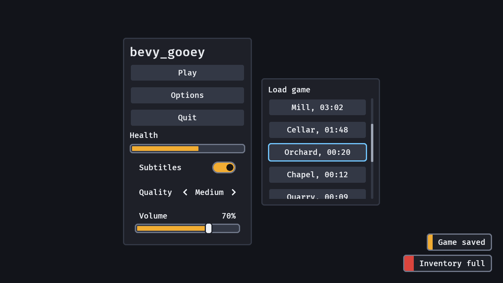

# bevy_gooey

Game interfaces made easy for Bevy 0.20: a skin, ready-made game widgets and keyboard and gamepad navigation, on Bevy's own headless widgets.



## What you get

- **A skin**, `GooeySkin`: every colour and size as plain data, two presets (`dark`, `parchment`), a player text-scale option, and `problems()` to check it against the WCAG 2.2 contrast and target-size rules. Change it and everything on screen restyles that frame.
- **Widgets**, each a free function returning a bundle: `screen`, `panel`, `menu`, `heading`, `label`, `button`, `meter` (a HUD bar), `toggle` and `slider` (an options screen's switch and scrubber), `toast` and `toast_alert` (a line of news at the edge of the screen), `Tooltip` and the modal `dialog`.
- **Navigation**: arrows and the D-pad move focus to the nearest widget, Enter, Space and the pad's South button activate, Tab cycles.
- **Scale**: the whole interface keeps its share of the screen at every resolution, so text legible at 720p is legible on a 1440p monitor and a 4K television.
- **Feedback**: a `UiFeedback` message for every focus move and activation, for your sound.

## Install

From crates.io:

```toml
[dependencies]
bevy_gooey = "0.2"
```

Or from git, for changes not released yet:

```toml
[dependencies]
bevy_gooey = { git = "https://github.com/Ladvien/bevy_gooey" }
```

Features: `serde` (save and load a `GooeySkin` and `UiScaleSettings` as data).

## Quick start

```rust
use bevy::prelude::*;
use bevy_gooey::*;

fn main() {
    App::new()
        .add_plugins((DefaultPlugins, GooeyPlugins))
        .add_systems(Startup, setup)
        .run();
}

fn setup(mut commands: Commands) {
    commands.spawn(Camera2d);
    commands.spawn((
        screen(),
        children![(
            panel(),
            children![
                heading("Paused"),
                (
                    menu(),
                    children![
                        (button("Resume"), observe(|_: On<Activate>| info!("resume"))),
                        button("Quit"),
                    ]
                ),
            ]
        )],
    ));
}
```

Every widget composes inside `children![]`, and a button acts through an `Activate` observer. `cargo run --example gallery` shows them all.

## Navigation

- Arrow keys and the D-pad move focus to the nearest button in that direction (`navigate_by_input`); a pad moves focus, it never steers a cursor. The first key or D-pad press shows the focus ring (Bevy's `InputFocusVisible`) and a mouse click hides it again, so a mouse player never sees a stray ring and a pad player always sees theirs. A pad-first game that wants the ring from the first frame inserts `InputFocusVisible(true)`.
- Enter and Space activate the focused button (Bevy's own button handling) and flip the focused `toggle`; the pad's South button does both (`gamepad_select`).
- Tab and Shift+Tab cycle through a `screen`'s buttons.
- An open `dialog` holds focus: focus moves to its first button when it opens, Tab, the arrows and the D-pad cannot leave it, and closing it puts focus back on the button that opened it. Put `AutoFocus` on the dialog's safest choice ("Stay", "Cancel") to start there instead.
- A `Tooltip` opens when its widget has focus from a key or the pad, as it does under the pointer. It opens beside the widget (to the right in a column, below in a row, flipped at the window's edge), one step outside its panel, so it never covers the next button.
- A `Tooltip` is a view of its component: `commands.entity(button).remove::<Tooltip>()` takes the hint off (a "Locked: reach level 5" line once the player unlocks it), and inserting a new `Tooltip`, or editing `Tooltip.0`, changes the line the open tooltip shows.
- Put Bevy's `AutoFocus` on the button a screen should start on. With nothing focused (a click on empty space, a button despawned under the player), the first arrow or D-pad press lands there, or on the screen's first button in Tab order, and the next press moves on; with a `dialog` open it lands inside the dialog.

## Settings controls

`toggle` and `slider` are the two controls an options screen is made of. Each is one bundle whose root is Bevy's own headless widget (`Checkbox`, `Slider`), so the widget you spawn is the entity that carries its value, takes `observe`, `Tooltip` and `InteractionDisabled`, and says what changed through `ValueChange`:

```rust
fn options(mut commands: Commands) {
    commands.spawn((
        panel(),
        children![
            (toggle("Subtitles", true), observe(|c: On<ValueChange<bool>>| info!("subtitles {}", c.value))),
            (slider("Music", 0.7, 0.0..=1.0), observe(|c: On<ValueChange<f32>>| info!("music {}", c.value))),
        ],
    ));
}
```

- A **toggle** is a row: the label on the left, a framed switch on the right whose knob slides to the end and fills with the accent when on. Its state is the knob's place first and its colour second, so it reads for a colour-blind player. It flips by itself (`Checked` on the entity); a click anywhere on the row, Enter, Space and South flip it, and `ValueChange<bool>` is the moment to apply the setting.
- A **slider** is a row: the label and the value (a percentage for a range of 0 to 1, the number otherwise) over a rail with a thumb. The whole row is the target: a click puts the thumb under the pointer and a drag goes on from there. With it focused, Left and Right step by a twentieth of the range (insert a `SliderStep` to change it), Home and End jump to the ends, and Up and Down still move focus on. The D-pad does the same, and a held direction repeats after 0.4 s at 12 steps a second (`PAD_REPEAT_DELAY`, `PAD_REPEAT_RATE`), so a pad player never presses A to select the slider nor holds a button to keep it. `ValueChange<f32>` fires as the value moves (`is_final` is false until the drag ends); read the value from `SliderValue`, or write one to move the slider.
- Both are targets at least `min_target` high, show the same focus ring as a button, and grow with `text_scale`.

## Toasts

A toast is one spawn from any system, with no layout and nothing to set up:

```rust
fn save(mut commands: Commands) {
    commands.spawn(toast("Game saved"));
}

fn pickup_failed(mut commands: Commands) {
    commands.spawn(toast_alert("Inventory full"));
}
```

- The first toast creates the one `ToastStack` (a full-window, pointer-transparent column above a `dialog`'s scrim and below a tooltip) and every toast becomes its child in the frame it is spawned. Despawn the entity to take a toast back sooner.
- A toast stands as long as its message takes to read: `(base_seconds + characters ÷ chars_per_second) × duration_scale`, 2.5 s for "Game saved" at the defaults, then fades out and despawns. It runs on real time, so a paused game's menu still ages it.
- Offer `ToastSettings::duration_scale` in your settings screen: Xbox Accessibility Guideline 116 asks that a player can stretch the time notifications stay up to at least ten times the default (any value above zero works). `fade_seconds: 0` removes the fade and the small rise for a player who wants no motion. `max_visible` (3) sends the oldest into its fade when a fourth arrives, and `anchor` picks one of six places (bottom centre by default); the newest stands nearest the edge.
- A toast takes no input and no focus: every node of it is `Pickable::IGNORE`, it is no tab stop, and a press, a key or a D-pad direction goes to what is under it. The mark down its left edge is the accent for `toast` and `danger` for `toast_alert`; the words carry the kind too. `GooeySkin::problems()` checks both marks against the toast's surface at 3:1.
- A toast is not announced to screen readers yet: it is visual only.

## Over a game world

A `screen` is layout, not a surface: its empty part is `Pickable::IGNORE`, so a HUD on it lets the pointer through to the sprites, meshes and UI roots under it (a world sprite opts in to picking with `Pickable::default()`), while a `panel`, `button`, `meter` or `dialog` on it still takes the pointer, so a click on one never reaches the world. A click on the empty part still blurs the interface. A menu screen that must swallow the pointer: `commands.spawn(screen()).insert(Pickable::default())`.

## Skins

`GooeySkin::dark()` is the default; `GooeySkin::parchment()` is the light one. Edit the resource live (an options screen, or an editor) and `apply_skin` restyles every widget that frame. With the `serde` feature a skin is RON or any serde format, and a partial file fills the rest from the default, so a project saves only what it changed:

```ron
(accent: Srgba((red: 0.2, green: 0.6, blue: 0.9, alpha: 1.0)), text_scale: 1.25)
```

`GooeySkin::problems()` lists what a skin breaks, and the plugin warns once per problem when the skin changes (it never refuses one):

- text under 4.5:1 contrast against the surface, the raised surface, a hovered button, or the accent (WCAG 2.2, 1.4.3);
- a focus ring under 3:1 against the raised surface (WCAG 2.2, 1.4.11);
- a meter's fill (the accent) under 3:1 against its track, or its frame (`outline`) under 3:1 against the panel, or an off switch's knob (`text_muted`) under 3:1 against its track, or a toast's mark (`accent`, `danger`) under 3:1 against the toast's surface (WCAG 2.2, 1.4.11);
- `min_target` under 24 px (WCAG 2.2, 2.5.8; the default is 44 px);
- a meter too thin to show a fill inside its frame and gap (`meter_height × text_scale` at most 4 × `border`);
- a size that is not finite, or not positive where it must be.

Fonts are yours: set `GooeyFonts { body, heading }`. The default draws Bevy's built-in font when Bevy's `default_font` feature is on.

## Screen size

`GooeyScalePlugin` (in `GooeyPlugins`) sets Bevy's `UiScale` from the window's shorter side, so every widget, gap, border and line of text keeps its share of the screen: the skin's sizes are what a 1280x720 window shows, a 1920x1080 window draws them at 1.5x and a 2560x1440 one at 2x. The default text then stays above the Xbox Accessibility Guidelines' console minimum (26 px at 1080p, 52 px at 4K) on any screen. `UiScale` multiplies every `Val::Px`, so your own UI nodes scale with the crate's.

- `UiScaleSettings { reference_short_side, scale }`: the window size at which the skin's sizes are drawn as they are (720; a game designed at 1080p sets 1080), and the player's interface size on top (1.0). `GooeySkin::text_scale` enlarges text alone; `scale` enlarges everything.
- A minimised window keeps the last scale.
- Every line (a panel's or a button's border, the focus ring, a meter's frame and the gap round its fill) is drawn a whole number of device pixels wide, rounded down as CSS rounds a border, so it is one weight on all four sides at any scale: a 3 px border is 4 px at 1920x1080 (1.5x) and 3 px at 1280x800 (1.11x), and the meter's fill sits centred in its slot. `snap_line_width` is the rule.
- The plugin owns `UiScale`. To drive it yourself, leave the plugin out: `GooeyPlugins.build().disable::<GooeyScalePlugin>()`.

## Feedback

Read `UiFeedback` (`entity`, `kind: Focus | Activate`) and play a sound: a button, a toggle and a slider each focus, and a button's activation and a toggle's flip activate. The crate plays none.

## What this crate does not own

World-space speech balloons and dialogue belong to `bevy_speech_bubbles`; the game's states and pausing, to the game. Audio is the host's: it hears `UiFeedback`. Localization is the host's: every widget takes the string to show. Fonts are the host's: it fills `GooeyFonts`.

## License

MIT OR Apache-2.0.
