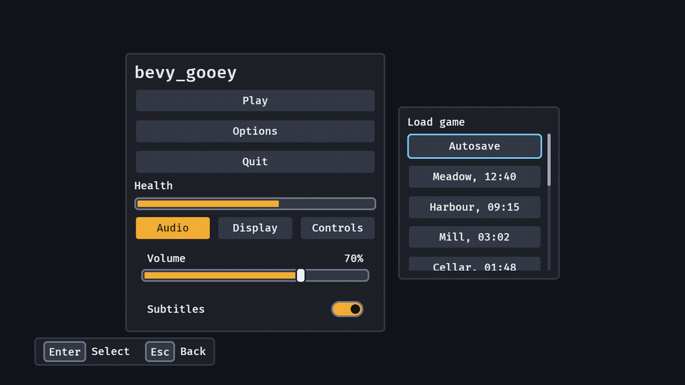

# bevy_gooey

> ⚠️ **Vibe Coded.** Written by AI agents working from a human's direction, covered by tests rather than a line-by-line human review. Read the code before you rely on it for something you care about.

Game interfaces made easy for Bevy 0.20: a skin, ready-made game widgets and keyboard and gamepad
navigation, on Bevy's own headless widgets.

[](https://crates.io/crates/bevy_gooey)
[](https://docs.rs/bevy_gooey)
[](https://github.com/bevy-coven/bevy_gooey/actions/workflows/ci.yml)
[](https://bevyengine.org)
[](#who-and-licence)



*`examples/gallery`: two panels, a meter draining, a switch, a choice, a slider, a list that scrolls to
follow focus, and toasts.*


*The still: every widget on one screen, the dark skin, 1280 × 720.*

**Status:** usable · Bevy 0.20 · MSRV 1.97.1

**Why:** Bevy gives you layout and picking but no skin, no focus ring a pad player can follow and no
ready-made options row, so every game rebuilds the same menu — `bevy_gooey` makes one crate's worth of
it shared, checked against the WCAG 2.2 contrast and target-size rules, and editable as data.

## Quick start

```sh
cargo add bevy_gooey
```

```rust
use bevy::prelude::*;
use bevy_gooey::*;

fn main() {
    App::new()
        .add_plugins((DefaultPlugins, GooeyPlugins))
        .add_systems(Startup, setup)
        .run();
}

fn setup(mut commands: Commands) {
    commands.spawn(Camera2d);
    commands.spawn((
        screen(),
        children![(
            panel(),
            children![
                heading("Paused"),
                (
                    menu(),
                    children![
                        (button("Resume"), observe(|_: On<Activate>| info!("resume"))),
                        button("Quit"),
                    ]
                ),
            ]
        )],
    ));
}
```

Every widget composes inside `children![]`, and a button acts through an `Activate` observer. From git,
for changes not released yet:

```toml
[dependencies]
bevy_gooey = { git = "https://github.com/bevy-coven/bevy_gooey" }
```

Features: `serde` (save and load a `GooeySkin` and `UiScaleSettings` as data).

## Try it

```sh
cargo run --example gallery
```

Every widget on one screen, exactly what the two pictures above show: arrows or the D-pad move focus,
Enter, Space and South activate, Shift+T doubles the text, Options swaps the skin, Quit opens a dialog,
and the save-slot list scrolls with the wheel, a drag on its thumb or PageUp and PageDown.

## What you can do

- **Skin the whole interface from one value** — `GooeySkin` is plain data with two presets and a
  `problems()` check against the WCAG 2.2 contrast and target-size rules:
  [skins and checks](https://github.com/bevy-coven/bevy_gooey/blob/main/docs/guide/skins.md).
- **Build an options screen from three rows** — a `toggle`, a `choice` and a `slider` root on Bevy's own
  `Checkbox`, `Button` and `Slider`, so the entity you spawn carries its value, takes `observe` and says
  each change once in `ValueChange`: [settings controls](https://github.com/bevy-coven/bevy_gooey/blob/main/docs/guide/controls.md).
- **Scroll a list that follows the focus** — `list(4.5, children![..])` cuts the fifth row so the player
  sees there is more, and keeps the next row in sight as the arrows walk down it:
  [lists](https://github.com/bevy-coven/bevy_gooey/blob/main/docs/guide/lists.md).
- **Reach every screen with keys or a pad** — arrows and the D-pad move focus to the nearest widget, an
  open dialog holds it, and the ring appears the moment a key is pressed:
  [navigation](https://github.com/bevy-coven/bevy_gooey/blob/main/docs/guide/navigation.md).
- **Say something without building a layout** — `commands.spawn(toast("Game saved"))` stacks, times
  itself to its own length and ages on real time:
  [toasts](https://github.com/bevy-coven/bevy_gooey/blob/main/docs/guide/toasts.md).
- **Keep the interface's share of the screen at every resolution** — the skin's sizes scale with the
  window, and every border stays a whole number of device pixels:
  [screen size](https://github.com/bevy-coven/bevy_gooey/blob/main/docs/guide/scale.md).
- **Let the pointer through a HUD** — the empty part of a `screen` is `Pickable::IGNORE`, so a click on
  the world under it still reaches the world: [over a game world](https://github.com/bevy-coven/bevy_gooey/blob/main/docs/guide/pointer.md).

The [guide index](https://github.com/bevy-coven/bevy_gooey/blob/main/docs/guide/README.md) lists the rest: every widget in one table, what a host touches
and what it only sees, and the boundary with the game.

## Part of the Coven

`bevy_gooey` is one of the [Bevy Coven](https://github.com/bevy-coven) crates: the family table there
says which crate owns what, so two of them never both own the interface. Grimoire, the Coven's level
editor, takes it as an optional feature and edits a project's skin as the crate's own `GooeySkin` —
see [use it in Grimoire](https://bevy-coven.github.io/crates/bevy_gooey.html#use-it-in-grimoire).

## Bevy compatibility

| `bevy_gooey` | Bevy |
|---|---|
| 0.1 – 0.3 | 0.20 |

## Learn more

- [docs.rs](https://docs.rs/bevy_gooey) — the API reference (`cargo doc --open`).
- [The book page](https://bevy-coven.github.io/crates/bevy_gooey.html) — the same guide with the pictures.
- [`docs/guide/`](https://github.com/bevy-coven/bevy_gooey/blob/main/docs/guide/README.md) — the detail: navigation, controls, lists, toasts, skins, screen
  size, the pointer, feedback.
- [`examples/`](https://github.com/bevy-coven/bevy_gooey/tree/main/examples) — `gallery`, every widget on one screen.
- [`docs/media/README.md`](https://github.com/bevy-coven/bevy_gooey/blob/main/docs/media/README.md) — how every picture here is made.
- [`CHANGELOG.md`](https://github.com/bevy-coven/bevy_gooey/blob/main/CHANGELOG.md) — what each release changed, and what it broke.

## Who and licence

Maintainer [@Ladvien](https://github.com/Ladvien). Questions and bugs go to
[the issues](https://github.com/bevy-coven/bevy_gooey/issues), and a game asking for a change here uses
the `consumer` label. Contributions follow the org's
[`CONTRIBUTING.md`](https://github.com/bevy-coven/.github/blob/main/CONTRIBUTING.md); the crate's own
rules for changing it are in [`AGENTS.md`](https://github.com/bevy-coven/bevy_gooey/blob/main/AGENTS.md).

MIT OR Apache-2.0, at your option.
