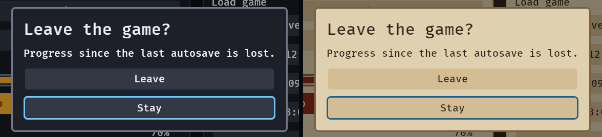

# bevy_gooey

> ⚠️ **Vibe Coded.** Written by AI agents working from a human's direction, covered by tests rather than a line-by-line human review. Read the code before you rely on it for something you care about.

Game interfaces made easy for Bevy 0.20: a skin, ready-made game widgets and keyboard and gamepad
navigation, on Bevy's own headless widgets.

[](https://crates.io/crates/bevy_gooey)
[](https://docs.rs/bevy_gooey)
[](https://github.com/bevy-coven/bevy_gooey/actions/workflows/ci.yml)
[](https://bevyengine.org)
[](#who-and-licence)


*`examples/gallery`: two panels, a meter draining, settings in tabs (a slider and a switch on the first), a list
that scrolls to follow focus with a field to name a save under it, toasts, and the Select and Back legend in the corner.*


*The still: the dark skin, 1280 × 720.*

**Status:** usable · Bevy 0.20 · MSRV 1.97.1

**Why:** Bevy gives you layout and picking but no skin, no focus ring a pad player can follow and no
ready-made options row, so every game rebuilds the same menu — `bevy_gooey` makes one crate's worth of
it shared, checked against the WCAG 2.2 contrast and target-size rules, and editable as data.

## Quick start

```sh
cargo add bevy_gooey
```

```rust
use bevy::prelude::*;
use bevy_gooey::*;

fn main() {
    App::new()
        .add_plugins((DefaultPlugins, GooeyPlugins))
        .add_systems(Startup, setup)
        .run();
}

fn setup(mut commands: Commands) {
    commands.spawn(Camera2d);
    commands.spawn((
        screen(),
        children![(
            panel(),
            children![
                heading("Paused"),
                (
                    menu(),
                    children![
                        (button("Resume"), observe(|_: On<Activate>| info!("resume"))),
                        button("Quit"),
                    ]
                ),
            ]
        )],
    ));
}
```

Every widget composes inside `children![]`, and a button acts through an `Activate` observer. From git,
for changes not released yet:

```toml
[dependencies]
bevy_gooey = { git = "https://github.com/bevy-coven/bevy_gooey" }
```

Features: `serde` (save and load a `GooeySkin` and `UiScaleSettings` as data).

## Try it

```sh
cargo run --example gallery
```

Every widget on a screen, what the pictures above show: arrows or the D-pad move focus, Enter, Space and
South activate, Shift+T doubles the text, Options swaps the skin, Quit opens a dialog, Right on a focused
tab or Ctrl+PageDown turns the settings page (Display holds the choices, Controls two rebinding rows: Enter
on Jump, then a key), the Save as field takes a name (click it or Tab to it, type, Enter saves and Down
leaves it, and the save-slot list scrolls with the wheel, a drag on its thumb or PageUp and PageDown.
`cargo run --example options` is the player's options on a screen of their own: Left and Right on Text size
grow everything to 200%, and Controller renames the pad's buttons.

## What you can do

- **Skin the whole interface from one value** — `GooeySkin` is plain data with four presets (dark,
  parchment, a high-contrast one held to 7:1 and a compact `Tool` one), a `problems()` check against the
  WCAG 2.2 contrast and target-size rules, `density: Density::Compact` for a desktop tool's rows (half
  the padding, a 24 px least target), design tokens (`spacing`, `radii`, `type_scale` and a `surfaces`
  ladder of five fills whose every step `problems()` holds to at least ΔL\* 2, drawn by `surface(n)`),
  and a `SkinScope(skin)` on any node restyles just that subtree (a preview of a theme, an editor's own
  chrome next to a game's skin):
  [skins and checks](https://github.com/bevy-coven/bevy_gooey/blob/main/docs/guide/skins.md).
- **Build an options screen from a few rows and tabs** — a `toggle`, a `choice` and a `slider` root on
  Bevy's own `Checkbox`, `Button` and `Slider`, so the entity you spawn carries its value, takes `observe`
  and says each change once in `ValueChange`, `binding("Jump", Binding::Key(KeyCode::Space))` rebinds a
  key, a mouse button, a pad button or a chord ("Ctrl+Shift+K") on the player's next press, `text_input("Name", "")` is a field the
  player types in (a caret, a selection, paste and IME on Bevy's own `TextInput`, and focus it never
  traps), `tabs` puts them on pages a click, the arrows or LB and RB turn, and `text_size("Text size")`,
  `interface_size("Interface size")`, `pad_style("Controller")` and `skin_preset("Theme")` are the
  player's own text size (up to 200%), interface size, controller and theme (dark, parchment, a
  high-contrast look that holds 7:1 everywhere and a tool's blue), one line each with nothing to wire:
  [settings controls](https://github.com/bevy-coven/bevy_gooey/blob/main/docs/guide/controls.md),
  [player options](https://github.com/bevy-coven/bevy_gooey/blob/main/docs/guide/options.md),
  [rebinding](https://github.com/bevy-coven/bevy_gooey/blob/main/docs/guide/bindings.md),
  [shortcuts](https://github.com/bevy-coven/bevy_gooey/blob/main/docs/guide/shortcuts.md),
  [text input](https://github.com/bevy-coven/bevy_gooey/blob/main/docs/guide/text-input.md),
  [tabs](https://github.com/bevy-coven/bevy_gooey/blob/main/docs/guide/tabs.md).
- **Scroll a list, split the screen and dock panels** — `list(4.5, children![..])` cuts the fifth row so the
  player sees there is more; `split(SplitAxis::Horizontal, a, b)` is two panes and a divider a drag or the keys move;
  `dock(DockLayout)` is tab groups of your registered panels that the player rearranges by dragging a tab, the layout plain data:
  [lists](https://github.com/bevy-coven/bevy_gooey/blob/main/docs/guide/lists.md), [split panes](https://github.com/bevy-coven/bevy_gooey/blob/main/docs/guide/splits.md), [docks](https://github.com/bevy-coven/bevy_gooey/blob/main/docs/guide/docks.md).
- **Reach every screen with keys or a pad, and back out of it** — arrows and the D-pad move focus to the
  nearest widget, an open dialog (a framed panel with a title, a line of body and its choices) holds it,
  the ring appears the moment a key is pressed, Escape or the pad's B is one `Cancel` event that
  reaches the dialog or screen you are leaving, and `prompts()` says so in the corner, in the words of
  the device the player used last ("Esc Back", then "B Back" the frame they pick up a pad):
  [navigation](https://github.com/bevy-coven/bevy_gooey/blob/main/docs/guide/navigation.md),
  [prompts](https://github.com/bevy-coven/bevy_gooey/blob/main/docs/guide/prompts.md),
  [the dialog](https://github.com/bevy-coven/bevy_gooey/blob/main/docs/guide/widgets.md#a-dialog).
- **Say something, or open a menu, without building a layout** — `commands.spawn(toast("Game saved"))`
  stacks, times itself to its own length and ages on real time, and `popover(anchor, Placement::Below)`
  opens a panel beside any widget or at the pointer, kept inside the window and closed by Escape or a
  press elsewhere:
  [toasts](https://github.com/bevy-coven/bevy_gooey/blob/main/docs/guide/toasts.md),
  [popovers](https://github.com/bevy-coven/bevy_gooey/blob/main/docs/guide/popovers.md); and
  `menu_bar(children![menu_title("File", children![menu_item("Open...").with_shortcut(..), separator(), ..])])`
  is a desktop menu bar for a tool, F10 and the arrows to walk it, with checks, radio runs, submenus and
  disabled items that say why: [menus](https://github.com/bevy-coven/bevy_gooey/blob/main/docs/guide/menus.md);
  and `ContextMenu(menu)` on any entity, a sprite in the world or a row of a list, opens a `context_menu(..)`
  at a right-click or below the focus on Shift+F10:
  [context menus](https://github.com/bevy-coven/bevy_gooey/blob/main/docs/guide/context-menus.md);
  and `commands.spawn(command_palette())` is one searchable list of every command in a `CommandList`, each
  with its chord and why it is off, "opn prj" finds "File: Open Project", Enter sends one `RunCommand`:
  [the command palette](https://github.com/bevy-coven/bevy_gooey/blob/main/docs/guide/command-palette.md).
- **Keep the interface's share of the screen at every resolution, and let the pointer through a HUD** — the
  skin's sizes scale with the window, every border stays a whole number of device pixels, and the empty part
  of a `screen` is `Pickable::IGNORE`: [screen size](https://github.com/bevy-coven/bevy_gooey/blob/main/docs/guide/scale.md),
  [over a game world](https://github.com/bevy-coven/bevy_gooey/blob/main/docs/guide/pointer.md).


*The tabs: Right on a focused tab, then Ctrl+PageDown from inside a page (a pad's RB). The panel never moves.*


*Rebinding: `binding("Jump", Binding::Key(KeyCode::Space))` waits for the next press and says it once as a `ValueChange<Binding>`. The panel never moves, and nothing else hears the key.*

![The shortcuts example: a Keymap panel with three rows, Save, Save all and Palette, each showing a chord on a keycap (Ctrl+S, Ctrl+Shift+S, Ctrl+P), a conflict line, a line naming the command that ran and a Save button; Enter on Save lights its keycap amber with "Press a shortcut, Esc exits" and Ctrl+Shift+K turns the keycap from Ctrl+S to Ctrl+Shift+K; the same chord on Save all makes the line read "Conflict: Save and Save all" and Ctrl+Alt+J clears it; Ctrl+Shift+K runs Save, and the ring on the Save button opens its tooltip, "Write to disk" with Ctrl+Shift+K on a keycap](https://raw.githubusercontent.com/bevy-coven/bevy_gooey/main/docs/media/shortcuts.gif)

*Shortcuts: a `binding` row whose value is a `Binding::Chord` captures a key chord; `model::shortcut_conflicts` finds two commands on one chord; `Shortcut::just_pressed` runs the command; `Tooltip::new("Write to disk").with_shortcut(chord)` shows it on a keycap.*


*Text input: `text_input("Save as", "")` takes the keys the moment it has focus, says each edit once as a `ValueChange<String>` and the end of the edit (Enter, or focus leaving) with `is_final`. Up leaves it: a field never traps focus, and the row never moves while the player types.*

![The options example: a panel with the rows Text size, Interface size, Controller and Theme and the legend in the bottom-left corner; the ring on Text size steps 100%, 125%, 150% and 200% and the panel and the legend grow with each step, then back to 100%; Interface size steps to 125% and 150% and back; a pad button turns the legend to "A Select, B Back" and Controller steps to PlayStation, where it reads "Cross Select, Circle Back", then Switch and back to Xbox; Theme steps to Parchment and to High contrast, where the screen turns black with white frames, and back](https://raw.githubusercontent.com/bevy-coven/bevy_gooey/main/docs/media/options.gif)

*Player options: `text_size`, `interface_size`, `pad_style` and `skin_preset` each edit the crate's own settings and follow them, so a loaded save shows on them and the whole screen answers the frame the player steps one.*


*Theme: `skin_preset("Theme")` is the high-contrast mode Xbox Accessibility Guideline 102 asks of a game, in one line: every colour at 7:1 or more. A step writes the colours and no size, so the player's text size stays.*

![The scope example: an Options panel with Text size, Theme, Subtitles, Volume and Play beside a smaller cream and brown Preview panel; Theme steps to Parchment and High contrast and Text size to 125% and 150%, the Options panel changing each time while the Preview stays cream, brown and at the default size; the ring goes down to Play and across to the Preview's own Play, where it is blue, and Enter takes the scope off: the Preview turns black with white frames, amber fills and 150% text, with a cyan ring](https://raw.githubusercontent.com/bevy-coven/bevy_gooey/main/docs/media/scope.gif)

*Scoped skin: `SkinScope(GooeySkin::parchment())` on the Preview panel is the only thing that keeps it in its own look; removing it hands the panel back to the player's skin in the same frame.*


*Density: `skin.density = Density::Compact` is one field; every row halves its padding and stands at least 24 px high (WCAG 2.2 SC 2.5.8's floor, still checked), and the colours, the ring and the keys do not change: here the panel goes from 528 px to 456 px at the same 20 px text. `SkinPreset::Tool` is a blue-on-grey look with 14 px text and tighter sizes: the gallery's settings panel is 294 px tall in it against 520 px in dark.*


*Tokens: `surface(n)` is step `n` of `skin.surfaces`, and `problems()` reports an `ElevationStep` when two neighbours are closer than ΔL\* 2 (the eye's threshold for a flat field); the four presets sit at 5 or more. The cards' padding and corners are `skin.space(3)` and `skin.corner(1)`.*


*Popovers: `popover_modal(file_button, Placement::Below)` opens a menu under its anchor that holds focus and gives it back; at the window's edge it slides or flips and never leaves the window, and Escape or a press anywhere else closes it with one `PopoverClosed`.*


*Menus: `menu_bar(children![menu_title("File", children![menu_item("Open...").with_shortcut(..), ..])])`, F10 and the arrows to walk it, Right into a submenu, Escape one level at a time; a disabled item says why.*


*Context menus: `ContextMenu(menu)` on a crate, a row or any entity; a right-click opens the menu at the pointer (flipping at the window's edge), Shift+F10 or the Menu key below the focused widget, and `ContextTarget` says which thing a command was for.*


*The command palette: `CommandList` holds the commands, `command_palette()` is the modal, "opn prj" is a fuzzy match, Up and Down move the lit row while focus stays in the field, and Enter or a click sends one `RunCommand`; a command that is off shows why and runs nothing.*


*Docks: `dock(layout)` builds tab groups and splits from a `DockLayout` (plain data) and the panels you registered; a tab dragged onto a group, its edge or the dock's edge lights where it will land, Ctrl+Shift and an arrow does the same with no pointer, and each change is one `DockLayoutChanged` to save.*


*Back: the Quit dialog's one `Cancel` observer closes it on Escape, and on a pad's B. Focus returns to Quit.*


*Prompts: `prompts()` holds `prompt("Select", Prompt::SELECT)` and `prompt("Back", Prompt::BACK)`; the keycaps follow the last device the player used, and the legend moves nothing on the screen.*



*The dialog in both presets, 540 px wide here, the width of its line of body (a dialog is 420 to 720 px at the default size and grows with the text size); its edge is the skin's `outline` colour.*

## Part of the Coven

`bevy_gooey` is one of the [Bevy Coven](https://github.com/bevy-coven) crates: the family table there
says which crate owns what, so two of them never both own the interface. Grimoire, the Coven's level
editor, takes it as an optional feature and edits a project's skin as the crate's own `GooeySkin` —
see [use it in Grimoire](https://bevy-coven.github.io/crates/bevy_gooey.html#use-it-in-grimoire).

## Bevy compatibility

| `bevy_gooey` | Bevy |
|---|---|
| 0.1 – 0.17 | 0.20 |

## Learn more

- [docs.rs](https://docs.rs/bevy_gooey) — the API reference (`cargo doc --open`); [the book page](https://bevy-coven.github.io/crates/bevy_gooey.html) — the same guide with the pictures.
- [`docs/guide/`](https://github.com/bevy-coven/bevy_gooey/blob/main/docs/guide/README.md) — the detail: navigation, controls, lists, split panes, docks, toasts, skins, screen
  size, the pointer, feedback, every widget in one table, what a host touches and what it only sees, and the boundary with the game.
- [`examples/`](https://github.com/bevy-coven/bevy_gooey/tree/main/examples) — `gallery`, every widget on one screen.
- [`docs/media/README.md`](https://github.com/bevy-coven/bevy_gooey/blob/main/docs/media/README.md) — how every picture here is made.
- [`CHANGELOG.md`](https://github.com/bevy-coven/bevy_gooey/blob/main/CHANGELOG.md) — what each release changed, and what it broke.

## Who and licence

Maintainer [@Ladvien](https://github.com/Ladvien). Questions and bugs go to
[the issues](https://github.com/bevy-coven/bevy_gooey/issues), and a game asking for a change here uses
the `consumer` label. Contributions follow the org's
[`CONTRIBUTING.md`](https://github.com/bevy-coven/.github/blob/main/CONTRIBUTING.md); the crate's own
rules for changing it are in [`AGENTS.md`](https://github.com/bevy-coven/bevy_gooey/blob/main/AGENTS.md).

MIT OR Apache-2.0, at your option.
