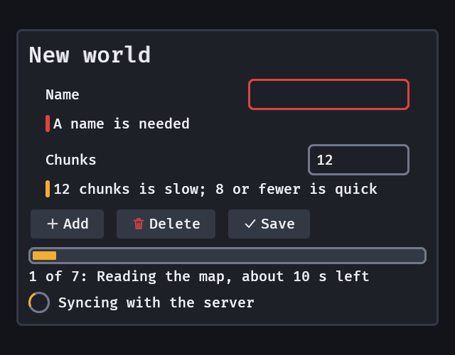

# Icons

`icon(source)` is a small image the skin sizes and tints: a toolbar glyph, the mark in front of a menu item, the bin on a Delete button. The crate ships no art. The host supplies one white-on-transparent image or atlas, and the skin makes it the colour the widget around it needs.

```rust
fn toolbar(mut commands: Commands, assets: Res<AssetServer>, mut layouts: ResMut<Assets<TextureAtlasLayout>>) {
    let image = assets.load("ui/icons.png");
    let layout = layouts.add(TextureAtlasLayout::from_grid(UVec2::splat(32), 8, 4, None, None));
    let delete = commands.spawn(button("Delete")).id();
    let bin = commands
        .spawn((
            icon(IconSource::Atlas { image, layout, index: 12 }),
            IconTone::Danger,
        ))
        .id();
    commands.entity(delete).insert_children(0, &[bin]); // before the label
}
```



- **The picture** is `IconSource::Image(handle)` or `IconSource::Atlas { image, layout, index }`. Change the `Icon` component and the picture changes the same frame.
- **The tint is a colour of the skin**, never a number in your code. The image is multiplied by it (a tint is a multiply, so a near-white icon takes any colour cleanly and a dark one cannot be brightened). `IconTone` picks it: `Text` (the default), `Muted` (`GooeySkin::text_muted`), `Accent` and `Danger`. A `Text` icon follows the widget it is in as the button's own text does: muted while the button is disabled, the accent's text while it is pressed. The others stay put.
- **The size is a step of the type scale**: `IconSize(2)` by default, the body's line (`GooeySkin::type_size(2)`, 20 px in the dark skin, 14 px in the Tool look), times the player's text size, so an icon is as tall as the text beside it at any size. `IconSize(0)` is the smallest step, `IconSize(4)` the largest.
- **A missing image** draws an empty box of the right size, so a toolbar never reflows, logs one warning and puts `IconMissing` on the icon. An image the asset server is still loading is not missing.
- **An icon takes no input and no focus** (`Pickable::IGNORE`, no `TabIndex`): a click on it lands on the button it is in. Put a visible label beside it. Nielsen Norman Group's finding is that "a text label must be present alongside an icon to clarify its meaning in that particular context", and an icon alone is a guess.
- **Warning and success tones** wait for named tones: the skin has no such colours yet.

A `Button` puts half a gap between an icon and its label (`column_gap`); a button of only a label is unchanged.
