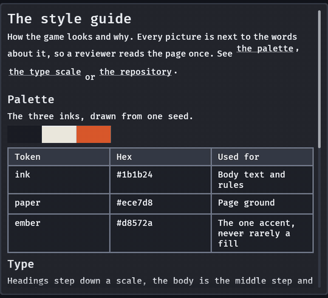

# A page of Markdown

`markdown_view(source, base)` draws a page of CommonMark, with tables, strikethrough and task lists, in the
skin's type scale, in a viewport that scrolls. A game's style guide, a tool's help page or an agent's notes
are files people read rendered, with the pictures in place. It is behind the `markdown` feature
(`bevy_gooey = { version = "…", features = ["markdown"] }`), which adds one dependency, `pulldown-cmark`
(MIT, no default features, builds for wasm32).



```rust
use bevy::prelude::*;
use bevy_gooey::*;

fn page(mut commands: Commands, assets: Res<AssetServer>) {
    let assets = AssetServer::clone(&assets);
    // Pictures are loaded by the host: the view asks for `guide/img/swatch.png` and keeps the handle.
    let base = MarkdownBase::new("guide", move |path: &str| Some(assets.load(path.to_owned())));
    commands.spawn((
        Node { width: Val::Px(640.0), height: Val::Px(480.0), ..default() },
        children.\n", base),
            observe(|link: On<MarkdownLink>| info!("open {}", link.dest)),
        )],
    ));
}
```

The view takes the room its host leaves, as a `list` does: give the host a height and the page scrolls
(the wheel, a trackpad, the rail), and a rail shows only while the page does not fit.

## What is drawn

| Markdown | Drawn as |
|---|---|
| `#` to `######` | `Role::MarkdownHeading(level)`: the heading face at the top three steps of `type_scale` (1, 2, then 3 to 6), with a stable id; its words go through the paragraph's path, so a link or a picture in a heading is drawn and listed |
| paragraphs, `**strong**`, `*emphasis*`, `~~strike~~`, `` `code` `` | one `Text` with a `TextSpan` for each change of look (bold and italic are the face's weight and slant; the host's font decides what they look like) |
| `[words](dest)` | a node of its own (below), underlined |
| `- item`, `1. item`, `- [x] done` | rows of a marker (`-`, `1.`, `[x]`, `[ ]`) and a column of the item's blocks; items nest |
| `> quote` | a bar in the outline down the left edge |
| `---` | a line the width of the page |
| a fence or an indented block | `Role::MarkdownCode`, the mono face in a frame |
| a table | a grid whose gaps are the lines (`Role::MarkdownTable`, `MarkdownHeadCell`, `MarkdownCell`); a column's `:---:` alignment is kept |
| `` | a picture (below), a block of its own whatever it stands in: a paragraph, a list item, a table cell |
| raw HTML | text, as written; never interpreted |

## Links

A link is a focusable node: Tab reaches it, Enter and the pad's South press it, a click presses it, and it
lights like a button. It sends `MarkdownLink { entity: the view, dest, kind }` where `kind` is
`markdown::LinkKind::Web` (`https://…`, `mailto:…`), `Relative` (`palette.md`, `../a.md#part`) or `Anchor`
(`#sizes`). **The view opens nothing**: the host decides what a destination means. An anchor also
scrolls the view to the heading it names, so a page's own table of contents needs no code.

A paragraph with no link is one `Text`. A paragraph with a link is a row that wraps, a node for each word
(the words glued to a link, such as a comma after it, share a no-wrap row with it), so the link is a
widget. A link that spans several words is one node and wraps as one.

## Pictures

`MarkdownBase::new(dir, resolver)` says where pictures come from. The view calls `resolver("dir/path")` once
for each picture when the page is built and draws the handle it returns through `image_box`, at the image's
own size (scaled down to 40 body text sizes wide; until it has loaded, a 16 by 9 body text size box).

A picture is drawn as a box of that size, in the outline, naming its alt text and its path
(`Role::MarkdownMissing`), and never as nothing, when

- the resolver returns `None`;
- the image fails to load (a handle the asset server reports `Failed`);
- its path leaves `dir` with `..`, starts at a root, or has a scheme other than http(s). The resolver is not asked, the page logs one
  warning and the view is sent `MarkdownImageRefused { dest, reason }`.

An `http://` or `https://` picture is handed to the resolver as written; the view does not fetch. Any other scheme (`embedded://`, `file://`, `data:`) is refused like a path that leaves `dir` (`PathRefused::Scheme`), because it would reach an asset source the directory does not hold. `markdown::image_path(dir, dest)` is the whole rule.

`markdown::images(source)` lists a page's pictures as `(range in the source, dest, alt)`, and
`markdown::links(source)` and `markdown::outline(source)` its links and headings, from the same parse the
view draws, so a host can check a page's paths before spawning anything. `markdown::resolve(dir, dest)` is
the path rule on its own. Each picture's node carries `MarkdownPicture` (its place in `images()`, its
`dest`, `alt` and `path`), so the order the view draws is the order `images()` lists.

## Headings

Each heading has a stable id: an explicit `{#id}` when the page gives one, else its words in lower case
with dashes (`Far down` is `far-down`), and a repeat counts up (`intro`, `intro-1`). `MarkdownOutline`
on the view lists them in order, and

```rust
commands.trigger(scroll_to_heading(view, "far-down"));
```

scrolls the view there (gliding on the skin's spring, or at once under reduced motion), the heading at
the top of the viewport or as near as the end of the page allows. An id the page does not have does nothing.

## Cost

A page is parsed and spawned when it is first on screen and when `MarkdownView::set_source` (or
`set_base`) changes it, never per frame; writing the words it already shows builds nothing.
`MarkdownBuilt(n)` on the view counts the builds. A 75 KB page with 40 tables is about 8,000 entities;
`cargo run --release --example markdown --features markdown` with `GOOEY_BUILD_TIME=1` prints what its
parse and spawn cost (see [the research note](../research/markdown-view.md) for the numbers).

## Not here

Footnotes, math, definition lists and HTML are left off or shown as text. An inline picture is a block of
its own, not a glyph in the line. A page whose words change often (an editor's live preview) rebuilds the
whole page each time: 15 to 17 ms for the 75 KB page of 40 tables in a release build, so a page of ordinary
size is a few milliseconds a keystroke.
