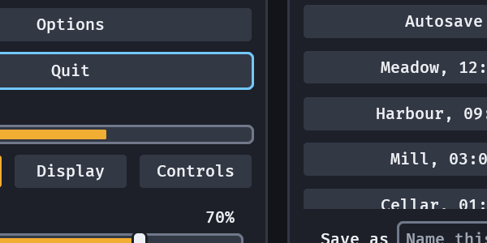
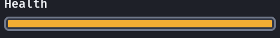
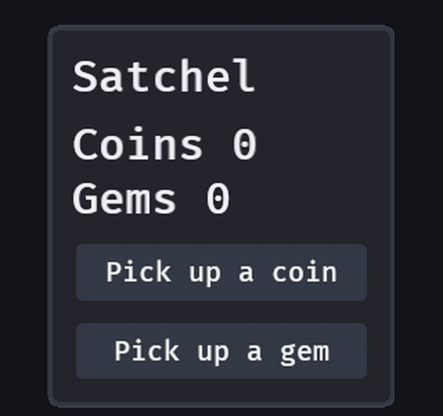

# Motion

A dialog's card rises into place and a menu opens out of its anchor, instead of appearing whole in
one frame, and a HUD meter that loses health leaves the lost length behind its fill before it drains.
There is nothing to write for any of it, and one setting turns it all off.

```rust,ignore
// A game's "Reduce motion" option: nothing travels, fades stay.
commands.insert_resource(MotionSettings::reduced());
// Or no motion at all, fades included.
commands.insert_resource(MotionSettings::off());
```





## What moves

| What | How | On |
|---|---|---|
| A dialog's card (a `panel()` or the palette's card inside a `dialog()` scrim) | rises `DIALOG_SLIDE_PX` (12 px) | `motion.snappy` |
| A popover's panel (`popover`, `popover_modal`, menus, context menus, select lists, the colour picker) | opens `POPOVER_SLIDE_PX` (6 px) closer to its anchor and at `POPOVER_SCALE_FROM` (0.96) scale, fading in (`motion.fade_seconds`), then settles at its gap and at scale 1; it fades out where it stands when it closes (a menu's panel then goes out of sight, ready for the next opening) | `motion.snappy` |
| A `meter()` that loses value | the fill drops to the new value in that frame; a `Role::MeterTrail` in `danger` keeps the lost length, holds, then drains to the fill | hold `METER_TRAIL_HOLD_SECONDS` (0.45 s), then `METER_TRAIL_RATE` (1.5 bars a second) |
| A `meter()` that gains value | the fill rises to it; no trail | `motion.snappy` |

Every rise is a spring ([`Spring`](https://docs.rs/bevy_gooey/latest/bevy_gooey/model/struct.Spring.html):
a perceptual duration and a bounce, SwiftUI's mapping), not a fixed-length curve: it starts quickly,
settles with no end the eye can see, and if it is interrupted it carries on from where it is drawn
and how fast it is going. They run on real time, so a menu opened in a paused game still moves. A
tooltip, a toast (which has its own room that opens) and a context menu at the pointer do not slide.

Only the picture moves. Layout and focus are the final ones from the first frame: focus lands in a
dialog in the frame it opens and `ComputedNode` sizes never change; the hit target moves with what is
drawn, so a click in the middle of a slide lands on what the player sees. A popover is drawn a frame
after it is spawned (Bevy lays its text out first); the slide's clock waits for that frame, so all of
it is seen.

## The skin's springs

`GooeySkin::motion` is the palette every motion draws from, so a whole interface has one feel:

| Token | Duration | Bounce | For |
|---|---|---|---|
| `snappy` | 0.25 s | 0 | small controls, entrances, pop-ups |
| `default` | 0.3 s | 0 | the ordinary state change |
| `calm` | 0.4 s | 0 | larger things that arrive |
| `lead` | 0.2 s | 0 | a thing that leads another |
| `fade_seconds` | 0.15 s | | an opacity change |

The duration is *perceptual*, the period of the undamped spring; the time to come to rest is longer
(`model::spring_settle_seconds`: about twice it with no bounce). Bounce 0 arrives and stops; above 0
overshoots, below 0 is flatter. A spring that has no motion (a duration of zero, a bounce outside -1
to 1) is `SkinProblem::BadMotion`. A theme step (`with_colours_of`) leaves the palette alone.

## A meter's trail

```rust,ignore
commands.spawn(meter(100.0, 100.0)).insert(Health);
// later: a hit for 40
meter.value -= 40.0;
```

Change `Meter::value` and the bar does the rest (`model::meter_motion` is the maths, with no engine type).
The fill is always exact: on a loss it is at the new value in the frame you wrote it, never lagging
behind the truth, and the trail is the extra, saying how much was taken. A second hit during the hold
does not restart it (a stamina bar that drains every frame would hold forever otherwise). The first
frame of a meter is its value, not a rise from empty. A meter with no `Time<Real>` (a host without the
clock) jumps as before. The trail is a second child of the track, zero wide at rest, so a settled
HUD draws and writes exactly what it did before. The gallery stages it: `GOOEY_KEYS=hit,hit,heal`.

## The one setting

`MotionSettings { duration_scale, reduced }` is a resource (serde, `Reflect`; `GooeyStylePlugin` adds it
with the defaults 1 and `false`):

- `duration_scale` `1.0` as designed; `2.0` takes twice as long.
- `reduced: true`, or `MotionSettings::reduced()`, is "Reduce motion": the crate's travel lands and fades
  still run. Every `MotionTarget` lands at once, and so do a popover's slide and a meter's fill; a spinner
  and a hold bar are progress, not travel, and keep moving.
  A dialog's card and a popover panel are in place on their first frame and fade in over the skin's
  `motion.fade_seconds` (0.15 s, times `duration_scale`) on an ease-in-out, and an exit (`Leave`) still
  fades out. Turning it on mid-flight lands what is travelling in the next frame and lets a fade finish.
- `duration_scale` `0.0`, or `MotionSettings::off()`, is no motion at all: nothing starts, fades included,
  and a slide or a trail that is running ends in the next frame. Off wins over reduced. WCAG 2.2 SC 2.3.3
  (Animation from Interactions) asks that motion triggered by interaction can be turned off unless it is
  essential, and an entrance never is.

`motion_row("Motion")` is the options screen's row for it: Full, Reduced and Off (`MOTION_STEPS`). Full and
Reduced keep the player's own `duration_scale` (1 coming from Off), a step writes `MotionSettings` and
nothing else, and a hand-written value shows the step it is in (`motion_step`). A host that localises
the words writes its own `choice` with `with_motion_step`.

The crate cannot read the operating system's own reduced-motion preference (Bevy has no way to), so a
game wires its own option, or reads the platform's and sets this.

## Your own panels: `MotionTarget`

```rust,ignore
// A side panel that arrives from the left, 24 logical px.
commands.spawn((
    Node::default(),
    MotionTarget::default().entering_from(Vec2::new(-24.0, 0.0)),
));
// Later, wherever it is drawn and however fast it is going, it turns to the new place:
commands.entity(panel).insert(MotionTarget { translation: Vec2::new(300.0, 0.0), ..default() });
```

`MotionTarget { translation, scale, rotation, spring, enter_from }` on any `Node` is a track on its
`UiTransform`. A change of any field starts a new spring segment from the *drawn* pose and its
velocity, so a second open, a key repeat or an interrupted close never jumps. The first target a node
has lands where it says (no motion on spawn) unless `enter_from` gives it a place to come from;
`InstantMotion` on the node lands its next change at once. A track at rest is skipped before anything
is read, and writes nothing. It follows `MotionSettings`; a game that writes `UiTransform` itself while
a track runs wins (the track is dropped); and the crate never replaces a `MotionTarget` a card already
carries. Do not put one on a `Popover`: Bevy's `Popover` measures where its panel is and corrects
`UiTransform` every frame, which would undo it (the crate's own popovers slide by their gap to the
anchor instead, `PopoverSlide`, and their scale, which Bevy's `Popover` never writes, rides the same
spring about the panel's own centre: `model::popover_scale`).

## Moving with layout: `MovesSmoothly`

```rust,ignore
// Cards in a row that slide over when one is taken out, instead of jumping.
commands.spawn((Node::default(), children![(panel(), MovesSmoothly), (panel(), MovesSmoothly)]));
```

A node with `MovesSmoothly` that layout puts somewhere else inside its parent is drawn where it was and
travels to the new place on the skin's `motion.default` spring, keeping its speed if it is moved again
on the way. Its children ride it. Layout is at the new place from the first frame: only the drawing
moves, and the picking with it. The corner is what is tracked, so a node that only grows does not move
(the one under it does).

A move lands at once in a node's first two frames (`LAYOUT_QUIET_FRAMES`), in the two frames after a
new window size, scale or skin and after the node gets a new parent, when its parent scrolls, and under
reduced or no motion. The two frames are there so that a fitting pass, which reads one frame's layout
and moves things in the next, never makes a resize glide. The crate marks tabs and a toggle's knob; a
dock's tabs are spawned again on each change to the dock's layout, so they do not travel yet (G-63).
Toasts glide on their own room, and toolbar and status items are moved by a fitting pass, so they are
not marked; a game marks what it likes. `LayoutTravel::offset()` says how far from its place a node is
drawn.

A marked node travels on `motion.default` unless it also has `TravelSpring(MotionToken)`, which names
the skin's spring that carries it. A `toggle`'s knob is the crate's own case: it travels from one end of
its track to the other on `motion.snappy`, so a switch answers a press quickly, and its track's colours
follow through colour motion. A value the game sets with no event (`Checked` inserted or removed)
travels the same, a second flip mid-flight carries on from where the knob is drawn, and a toggle that
starts on has its knob at the end from its first frame.

```rust,ignore
// A card that slides over on the calm spring when its neighbour is taken out.
commands.spawn((panel(), MovesSmoothly, TravelSpring(MotionToken::Calm)));
```

## Revealing on hover: `HoverGroup`

```rust,ignore
// A row whose close button shows only while the row is under the pointer or has focus.
commands.spawn((
    Node::default(),
    HoverGroup,
    children![label("Mixed.wav"), (button("x"), GroupReveal { rest: 0.0, hovered: 1.0 })],
));
```

`GroupReveal { rest, hovered }` on a node under a `HoverGroup` sets the node's `Opacity` from its group: `rest`
while the group is not hovered and `hovered` while it is, moving between them on a spring. It enters on
`motion.snappy` and leaves on `motion.default`, and if the pointer comes back mid-way it carries on from where it
is drawn. The group is hovered while the pointer is over it or anything in it, **while a press that began inside
it is still held** (a drag that takes the pointer off the row keeps the row revealed until the button is let go),
and **while it or anything in it has visible focus**, which reveals in that frame with no motion: a control that
only hover reveals would be an invisible tab stop. Reduced motion fades straight over `motion.fade_seconds`, no
motion lands, and a group that is settled writes nothing. The node's `Opacity` belongs to this while it has a
`GroupReveal`.

## Colours that ease

A hover, a focus ring, a selection, a disabled state and a skin change repaint on springs, in premultiplied
Oklab (`ColorTrack`, `update_color_motion`). A state change takes `motion.snappy`, a new skin `motion.calm`,
and a label or an icon's tint half as long as its fill, so the words lead the ground they sit on. A press
lands in its frame and its release eases. The first colours of a widget, a colour that is yours (a
`Role::Tone` node, a colour field's swatch) and a change of alpha alone land at once, and a settled widget
writes nothing. Reduced motion eases over `motion.fade_seconds`; `MotionSettings::off()` lands everything.
Two skins of opposite polarity must pass through a frame where a label is as bright as its fill; the label's
head start keeps those to a third of the calm spring at most.

## Sections and splits that open

A `section` that opens grows to its height and one that closes shrinks away, on the default spring, and
the widgets under it travel with it. A split collapsed or restored with Enter, South or a double click on
its divider slides its panes there. The state is the new one at once: `SectionOpen` and `SplitFraction`
say it in the frame it is asked for. Only the layout follows (`SectionGlide`, `SplitGlide` while it
does). A divider drag, an arrow-key step and a value your game writes move the panes at once, and reduced
motion makes both land at once.

## A tile that gives: `PressScale`

Every card of a `card_grid` and every slot of a `slot_grid` shrinks to 0.97 about its centre while a
press on it is held (`PRESS_SCALE`), on the snappy spring, and comes back with a slight bounce when it
is let go or the pointer leaves. Only the drawing scales: layout and the hit test keep the resting size,
so a press at the very edge stays on the tile. A scroll under the held press cancels it (the release
chooses nothing). Reduced motion keeps the tile at its size. Put `PressScale(0.96)` on a node of your
own that has a press state (a `Button`) for the same; buttons do not get it by default.

## A number that changed: `Pop`

`commands.entity(readout).insert(Pop::default())` swells a node by `POP_GAIN` (10%) about its centre and
settles it on the snappy spring with a slight bounce: the second feedback channel for a HUD number,
a chosen slot or a repaired panel, beside the words themselves. Inserting it again is a new pop (the
component is the trigger and stays), and a pop on a node still settling stacks on the scale it is drawn
at, so a counter that ticks five times in half a second reads as one fuller swell. `Pop(0.2)` is a
bigger one. Only the drawing scales, as for `PressScale` (layout and the hit test keep the resting size,
the two compose on one node), it runs on real time, so a paused game still pops its menu, and reduced or
no motion draws nothing swollen. It scales about the node's own centre: a readout stretched across a row swells about the row's middle, so let it hug its words (`align_items: FlexStart` on its parent). `examples/pop.rs` is the whole feature in one line. Research:
`docs/research/pop.md`.



## Testing motion

With the `testing` feature, `testing::MotionTrace` records a node's pose frame by frame on a manual
clock and answers what a hand-sampled test cannot: `max_step_px()` (no frame jumps), 
`max_speed_change_px_per_s()` (no snap in the speed), `settled_after_seconds()` and
`writes_at_rest(frames)` (a settled interface writes nothing).

## Cost

Two queries that skip a settled track before reading it, and a meter that is settled and unchanged is
skipped before any node is touched; the gallery's frame time does not move. Nothing is written after a
spring or a trail ends (`tests/motion.rs` counts `Changed<UiTransform>` and `tests/meter_motion.rs`
`Changed<Node>` over thirty idle frames).

Research and parameters: [`docs/research/motion.md`](https://github.com/bevy-coven/bevy_gooey/blob/main/docs/research/motion.md) and, for the meter, [`docs/research/meter-motion.md`](https://github.com/bevy-coven/bevy_gooey/blob/main/docs/research/meter-motion.md).

## Gliding from where a node was drawn: `TravelFrom`

`MovesSmoothly` carries a node to a new place in layout *within* one entity's life. A node that is spawned again
(a dock rebuilds its tabs on every change) has no old place, so give the new one `TravelFrom(centre)`: the
centre, in physical window pixels (the old node's `UiGlobalTransform::translation`), where it was drawn a moment
ago. At its first look in layout `update_layout_motion` starts the travel from there to where layout put it, and
takes the component off; reduced or no motion lands it. The crate does this for a dock's tabs
(`DockShown` keeps where each was drawn), so a dropped tab, a keyboard move and a changed layout glide.
