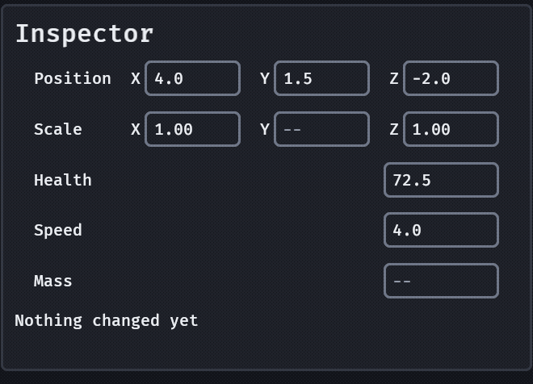

# Numbers

`number_field(label, value, step, range)` is a row for a number the player sets: a health, a speed, a mass. The label is on the left and a framed field on the right, the same field as [`text_input`](text-input.md) (a caret, a selection, paste, IME, focus it never traps), with a number behind it that three things change: a **drag**, the **keys**, and **typing**. `vec_field(label, [x, y, z], step, range)` is a label and a row of those, for a position or a scale.

```rust
fn inspector(mut commands: Commands) {
    commands.spawn((
        number_field("Health", 72.5, 0.5, 0.0..=100.0),
        observe(|change: On<ValueChange<f32>>| {
            if change.is_final {
                info!("health is {}", change.value);
            }
        }),
    ));
    commands.spawn((
        vec_field("Position", [4.0, 1.5, -2.0], 0.1, -1000.0..=1000.0),
        observe(|change: On<VecChange>| info!("{} is {}: {:?}", change.index, change.value, change.values)),
    ));
}
```



- **The state** is `NumberValue(f32)` on the row, with `NumberStep(f32)` and `NumberRange { min, max }` beside it; read it, or write it from code and the field shows it in the same frame with no event coming back. The row is also a `text_input` row, so its `TextInputValue` and `TextEditing` are there for the host (`is_text_editing` keeps a game's hotkeys quiet while the player types a number).
- **The event** is `ValueChange<f32>` on the row, once per change the player makes: `is_final` is false while a drag is still rolling the number and true when it ends, on Enter, when focus leaves after an edit, and for each key or D-pad step. A `vec_field` sends `VecChange { index, value, values, is_final }` on its row instead (the component that changed and the whole vector), and keeps `VecValue(Vec<f32>)`.
- **A drag scrubs.** Press on the label (or a vec component's letter, or the row's padding) and drag left or right: `value = start + distance × step`, so 50 px at a step of 0.1 is 5.0 (the distance is in layout px, so it is the same at any `UiScale`). **Shift** takes a tenth of that rate for fine work and **Ctrl** ten times it. The result is rounded to the digits of the step (no `5.000001`) and held to the range. A press that begins in the field is the field's, for the caret. A scrub is not typing: it takes focus off the field, so there is no caret and no ring while the number rolls, and the game's hotkeys are back.
- **Typing is never a mode.** A click, Tab or an arrow focuses the field with its number selected, so typing replaces it. **Enter** (or focus leaving the field after an edit) applies it: a number is held to the range and is one final change, shown as the field shows numbers (`2.50` is `2.5`). **Escape** puts the old number back and sends nothing. A typed word, an empty field or an expression such as `1.5*2` is refused: the field shows the number again and a `NumberRefused { text, reason }` is sent on the row; `reason` is a `model::NumberError` that reads as words ("type a number, not an expression"). Expressions are not evaluated.
- **The keys.** **Up and Down** step the focused field by `step` (**Shift** by ten), a held key repeats; this is the APG's spinbutton and it is why Up and Down do not leave a number field as they leave a text one: **Tab** does, and so does the D-pad's Up and Down. Left, Right, Home and End are the caret's. **A pad** steps with the D-pad's Left and Right, as it does a slider, and moves on with Up and Down, so a player with no keyboard and no mouse still sets any number (WCAG 2.5.7: a drag is never the only way, and the typed field is the other).
- **A mixed value.** `MixedValue` on the row (or `VecMixed(vec![false, true, false])` on a vec row, one flag per component) is a multi-selection whose members differ: the field is empty and shows a muted `MIXED_HINT` (`--`; an em dash is not in every font and the host supplies the font). `NumberValue` is the number a drag or a step starts from. Any change the player makes takes the marker off and is the one value for every member; Enter on the untouched field changes nothing. For a vec, the change is for that component only: apply `VecChange::value` to `index` of every member and leave the others.
- **The digits.** The field shows the digits of the step (0.1 shows one, 0.25 two, 1 none) and more when the number needs them, so the text never says another number than the value (`model::format_number`). A value you set outside the range is shown as it is; the range holds the player.
- **It never changes size.** The field is 10 characters wide at the body size (8 for a vec component); a longer number scrolls in it. The row is a `text_input` row's height, a target high, and a vec component's scrub handle (its padding, its letter and the gap) is at least 24 px wide.
- **A disabled row** (`InteractionDisabled` on it) does not scrub, step or take text.

The maths is in `model`, engine-free: `parse_number`, `format_number`, `number_decimals`, `scrub_value`, `step_value`, `NumberError`.

## What the crate does not do

- **No colour here.** [`color_field`](colors.md) is the same row with a swatch and a picker.
- **No unit suffix, wrap or log scale.** A label that says "m/s" is the game's.
- **No expression evaluation** (`1.5*2`): refused, with the reason, as Unity's `FloatField` does unless asked.
