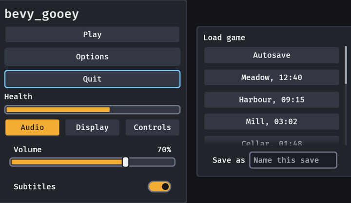

# Presence

A dialog that is dismissed, a menu that closes and a toast that has been read do not vanish between
two frames: they stay drawn and thin out over about a sixth of a second, and a second press can bring
one back from exactly where it is drawn. There is nothing to write for the crate's own widgets, and
one setting turns it off.

```rust,ignore
// A dialog as a game writes it: instead of `despawn()`.
commands.entity(dialog).insert(Leave);

// A panel the player drove away, and the button that calls it back.
commands.entity(sheet).insert(Leave);
commands.entity(sheet).insert(Stay);   // it turns round from where it is drawn
```



## What leaves

| What | How it goes |
|---|---|
| A `confirm(..)` question and its card | the whole dialog, veil included, fades out and despawns |
| A `popover`, `popover_modal`, menu, context menu, select list and colour picker | fades out where it stands, then despawns |
| A `command_palette` | the card thins out after focus is back on the opener |
| A toast | already ends with a fade of its own (`Toast::alpha`); a plain `despawn()` of one is still immediate |

Everything else closes exactly as before: a `despawn()` removes at once, for a node the player never
saw arrive.

## `Opacity`: one fade for a whole subtree

`Opacity(f32)` multiplies every colour the crate writes on a [`Role`](https://docs.rs/bevy_gooey/latest/bevy_gooey/enum.Role.html)
at or below it — fills, borders, text, an icon's tint, a text caret and a floating box's shadow — by
the product of the `Opacity` at and above each node, so a fade takes a panel's frame, its words and the
pictures in it together. A node the host draws itself, with no `Role`, is the host's and is left alone.

```rust,ignore
// A HUD panel that thins out as the player's health does, and comes back as it improves.
commands.spawn((panel(), Opacity(health_fraction), children![label("Low ammo")]));
```

A value outside 0 to 1 is held to the range and one that is not a number reads as 1, so a host's own
arithmetic can never make a widget disappear by accident. The skin's contrast checks (`problems()`)
read the skin, not a drawn node: they say what a widget looks like at rest, which is what a host has
to hold to.

## `Leave` and `Stay`

`Leave` is a component; adding it to any node starts the exit. The node fades on the skin's
`motion.fade_seconds` (0.15 s by default, times `MotionSettings::duration_scale`) and despawns within
`motion.default` plus a frame. In the frame the exit starts:

- every node of the subtree takes `Pickable::IGNORE`, so the pointer reaches what is under it at once;
- every `TabIndex` in it is taken off, so Tab and the arrows never land in something that is going;
- a `Dialog` is no longer a dialog, so focus returns to the widget that opened it in that same frame;
- anything else that had focus inside it has it let go.

All of that is recorded, and `Stay` puts it back: the fade turns round from where it is drawn, the
pointer and focus reach the node again in that frame, and it comes to rest at exactly the opacity it
had before anything asked it to leave. A `Leave` on a node already going changes nothing; the `Leave`
is spent the frame the exit starts. A `Leaving` component tells a game how far an exit has got
(`Leaving::opacity`, `Leaving::returning`).

A node hidden when its exit starts waits: a popover is drawn a frame after it is spawned, and the fade
does not begin until it is on screen.

## Turning it off

`MotionSettings::off()` is the player's "reduce motion" (WCAG 2.2 SC 2.3.3): a `Leave` under it despawns
in the frame it is asked, and no `Leaving` is ever added. An exit is never essential — the widget is
gone either way — so there is nothing to lose.

## What it costs

A settled interface writes nothing: `update_presence` returns before it reads anything when no node is
leaving, and an exit whose fade has landed either despawns or takes its components off. The colours a
fade writes are the same `apply_skin` writes, on `Changed<PresenceAlpha>`; the whole of a fade is
`Opacity` writes on one node per frame.
