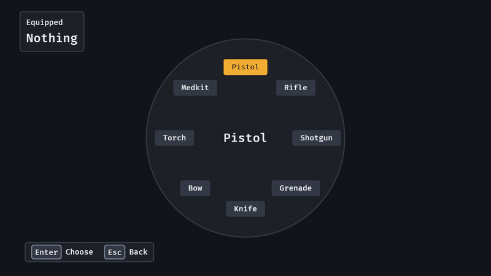

# Radial menu

`radial(items, selected)` is a weapon wheel, an emote wheel, a build menu or a companion-command wheel: the items stand on a ring round a disc (item 0 at the top, the rest clockwise) and the player **points** at one and chooses it. Pointing is by direction, never distance, so every item is as far away as every other and the player's thumb learns the way.

```rust
fn wheel(mut commands: Commands) {
    commands.spawn((
        radial(["Pistol", "Rifle", "Shotgun", "Grenade"], 0),
        AutoFocus,
        observe(|change: On<ValueChange<usize>>| {
            if change.is_final {
                info!("equip item {}", change.value);
            }
        }),
    ));
}
```



*`examples/radial`: the left stick pointing at each item in turn, South choosing Shotgun, Right twice and Enter choosing Knife.*

## How the player points

| Input | What it does |
| --- | --- |
| a stick (the left or the right one of any pad, whichever is pushed further) | pushed past half its travel, highlights the item it faces; short of that it changes nothing, so a stick drifting back through the middle never flickers between items |
| the pointer | over a wedge, highlights it (the whole wedge is the target, not just the label); in a dead circle in the middle (a quarter of the radius) it changes nothing |
| Right and Down, the D-pad's Right and Down | the next item, wrapping round |
| Left and Up, the D-pad's Left and Up | the previous item, wrapping round |
| Home, End | the first and the last item |
| South, Enter, Space, a click | choose the highlighted item |

The arrows and the D-pad move no focus off a radial (it keeps all four); Tab leaves it. The stick and the D-pad act on the radial **while it has focus**: a wheel a game opens for the player takes `AutoFocus`, or the game sets `InputFocus`.

## What the game hears

One event, `ValueChange<usize>` on the radial, the same one a `choice` sends:

- `is_final: false` each time the highlight moves (a stick, the pointer, a key). A game that previews as the player turns, a camera swinging to the item or a tooltip, uses this.
- `is_final: true` for the item chosen, once, **even when the highlight did not move** (a player who opens the wheel and presses South on the item it already points at has chosen it). Apply the choice on this one.

The highlight is `RadialValue` on the entity: read it, or set it to move the highlight from code; the screen follows the same frame and no event is sent for the game's own write. A value past the last item reads as the last.

**Release to select.** Most weapon wheels open while a button is held and choose when it is let go. The widget has no hold button of its own (the game owns its inputs), so the game triggers `Activate` on the wheel when the button is released:

```rust
commands.trigger(Activate { entity: wheel }); // `bevy::ui_widgets::Activate`
```

That sends the same final `ValueChange`. Showing and hiding the wheel (a `Display` or a spawn and despawn) is the game's too.

## Looks

The disc is 26 body text sizes across, so it follows `text_scale` and the player's interface size (416 px at the default size at 720p); the ring is 36% of that from the middle, drawn as a quiet circle the items stand on. It stops growing at 92% of the window's shorter side (662 px at 720p, at 125% text): past that the labels and the name stop growing with it, so the whole wheel is on the screen at 150% and 200% text too. Give it the middle of the screen; the status line and the legend stay in the corners. The highlighted item takes the accent fill with inverted text, the selected tab's look (two cues by luminance, not hue), and its name is read in the middle in the heading's size, where the thumb is. The disc's frame is the panel's and becomes the focus ring while it has focus. Three to eight short labels read best: eight labels of about seven characters stand clear of one another and inside the disc at every text size up to 200%, and ten of five or fewer do (`tests/radial.rs` lays both out); beyond that use a second wheel or a [`select`](select.md).

## Pictures

An item is a name, or a `RadialItem` with a picture. A picture item draws the picture on the ring and no words; its name is read in the middle when it is lit, which is the pairing craft guides ask for ("distinctive icons alongside concise labels") and the item's accessible name. Text and picture items mix on one wheel.

```rust
commands.spawn(radial(
    [
        RadialItem::new("Pistol").icon(IconSource::Image(pistol)),
        RadialItem::new("Rifle").icon(IconSource::Atlas { image, layout, index: 1 }),
        RadialItem::new("Unarmed"), // no picture: draws its name
    ],
    0,
));
```

The picture is white on transparent: the skin tints it like a button's icon (`text`, the accent's text on the lit item, muted when disabled), so it keeps its contrast in every preset. It is three body text sizes square (48 px at the default size, `Role::RadialIcon`) and its item is a square a little larger; it shrinks with the wheel in a short window. `GOOEY_PICTURES=1 cargo run --example radial` draws the weapons as pictures.


## Accessibility

A screen reader is told a spin button whose value is the highlighted item's name; name the wheel with `AccessibleLabel` (it has no label of its own to read). A wheel is never the only way to do something: a pointer, a stick and the keys all reach every item (WCAG 2.1.1 Keyboard: the arrows alone reach every item).

## Parameters

`RADIAL_STICK_PUSH` = 0.5 and `RADIAL_DEAD_ZONE` = 0.25 of the radius are constants in `model`, with the maths a game may reuse for its own wheel: `radial_pick(x, y, count)` (which wedge a direction faces; an edge belongs to the clockwise item), `radial_place(index, count)` and `radial_step(value, count, delta)`.

Research and sources: [`docs/research/radial.md`](https://github.com/bevy-coven/bevy_gooey/blob/main/docs/research/radial.md).
