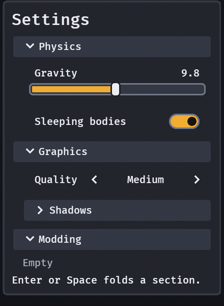

# Sections

A long inspector or settings screen stays scannable when its groups fold. `section(title, open, children)` is a header the player presses to fold a group of widgets away.

```rust
fn settings(mut commands: Commands) {
    commands.spawn((
        panel(),
        children![
            (
                section(
                    "Physics",
                    true,
                    children![slider("Gravity", 9.8, 0.0..=20.0), toggle("Sleeping bodies", true)],
                ),
                SectionId::new("physics"),
                observe(|fold: On<ValueChange<bool>>| info!("physics open: {}", fold.value)),
            ),
            section("Debug", false, children![toggle("Show colliders", false)]),
        ],
    ));
}
```



- **The children are any bundle** (`children![..]`, or `()` for none), so a section inside one is a nested section with no new API. The body is indented one and a half paddings so what is inside reads as inside.
- **The header is a button's look** (a raised bar at least `skin.target()` high, the ring, hover and press every button has) with a chevron that points right when closed and down when open. Enter, Space, South and a click toggle it.
- **`SectionOpen(bool)` is the state**, on the section's entity: read it, or set it from code and the section follows in the same frame with no event. A player's toggle sends **one `ValueChange<bool>`** on the section with the new state (APG's `aria-expanded`), which a game observes on the section.
- **A closed section is only its header.** Its body is `Display::None` (no layout) and `Visibility::Hidden` (Tab and the arrows skip it, as they skip a tab page that is not shown). Focus that is inside a body when it closes goes to the header, so it never rests on nothing.
- **`SectionId`** keeps the state across a despawn and a respawn: a section with an id is open or closed as the player last left the section of that name, whatever `open` it was spawned with (that is only the first choice, as Dear ImGui's `SetNextItemOpen(.., Once)` is). The states are the resource `SectionStates` (`open(id)`, `set(id, open)`, `clear()`; serde data with the `serde` feature), so a game can save it with the player's settings, insert it at start-up, or clear it to forget what the player folded. A section with no id keeps nothing.
- **An open section with nothing in it says "Empty"** in muted text, and loses the note when something is added.

`examples/sections.rs` shows it; `GOOEY_KEYS="tab;enter;down;down;down;enter"` folds Physics and opens Shadows.

Research: [`docs/research/sections.md`](../research/sections.md).
