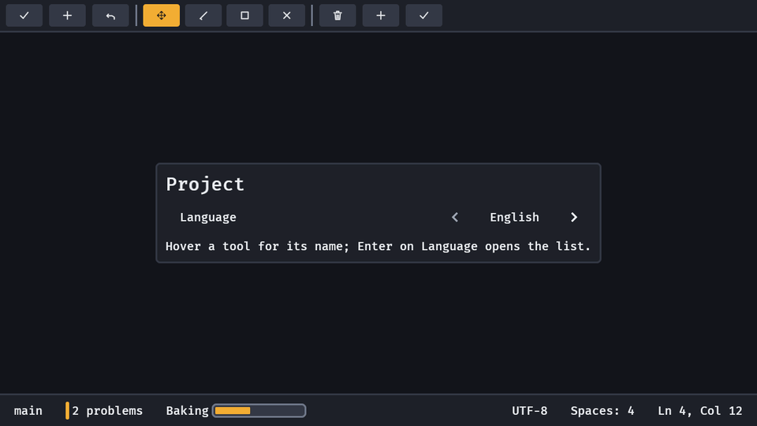

# Select

A choice of forty options needs a filter, not a row of buttons. `select(label, options, selected)` is a [`choice`](controls.md) with eight options or fewer, and with more it opens a searchable list.

```rust
fn language(mut commands: Commands) {
    commands.spawn((
        select(
            "Language",
            ["English", "Deutsch", "Español", "Français", "Italiano", "Nederlands", "Polski", "Português", "Svenska", "Dansk"],
            0,
        ),
        observe(|change: On<ValueChange<usize>>| info!("language {}", change.value)),
    ));
}
```



- **The row** looks and steps like a choice (a label, the chosen option between two arrows; Left, Right, Home and End and the D-pad step it, the arrows click) and its state is the same `ChoiceValue`. `select(..)` carries a `Select` component with the option strings; with more than `SELECT_FILTER_ABOVE` (8) of them, Enter, Space, South or a click on the row opens the list instead of cycling.
- **Typing a name** on a select of eight options or fewer steps it to the next option starting with what was typed within a second (one `ValueChange<usize>`, as a step); on a select that filters, typing does nothing until its list is open, where typing narrows it.
- **The list** is the command palette's card over the select's own options, so the field, the lit row, the keys and the look are one path: type to narrow it (the fuzzy rule of the palette: "par" finds "Paraguay"), Up, Down, PageUp, PageDown and the D-pad move the lit option while focus stays in the field, Enter, South or a click chooses it, Escape or a click outside closes it with the value unchanged and focus back on the row. It opens with the current option lit and the options in the order you gave them (not alphabetical), best match first while typing.
- **One change.** Choosing sends one `ValueChange<usize>` on the row with the option's index in your list, and none when it is the option the row already has. Set `ChoiceValue` from code and the row follows with no event.
- **No match** says "No option matches"; Enter chooses nothing and the list stays open.
- **It is the palette's card**, at the top of the window, not a popover under the row; a pad player walks the whole list with the D-pad, since there is no on-screen keyboard (`TextEditing` and `is_text_editing` are the host's hooks).
