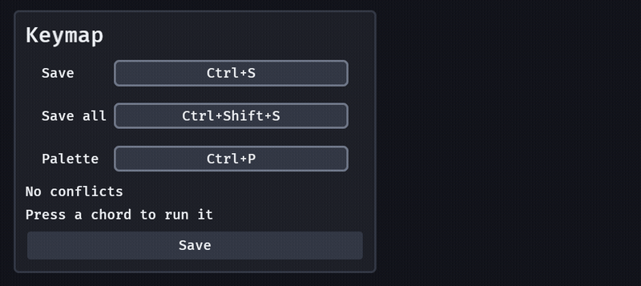

# Shortcuts

A `Shortcut` is a key chord as one value: a key and the modifiers held with it. A hint, a tooltip, a rebinding row and a conflict check all use it, so "Ctrl+Shift+P" is spelled the same way wherever the player meets it.

```rust
fn setup(mut commands: Commands) {
    // Command-S on a mac, Ctrl+S everywhere else.
    let save = Shortcut::primary(KeyCode::KeyS);
    let palette = Shortcut::new(Modifiers::CTRL | Modifiers::SHIFT, KeyCode::KeyP);

    commands.spawn((
        panel(),
        children![
            // The hint: "Save" and a keycap that says "Ctrl+S" (or "⌘S").
            (button("Save"), Tooltip::new("Write to disk").with_shortcut(save)),
            // The rebinding row: Enter on it, then hold Ctrl and Shift and tap a key.
            binding("Palette", Binding::Chord(palette)),
        ],
    ));
}

// A game's own handler: true on the frame the chord went down, with exactly these modifiers.
fn run(keys: Res<ButtonInput<KeyCode>>) {
    if Shortcut::primary(KeyCode::KeyS).just_pressed(&keys) {
        info!("save");
    }
}
```

- **The value.** `Shortcut { modifiers: Modifiers, key: KeyCode }` is `Eq + Hash`, reflected, and serde data under the `serde` feature, so a game saves its keymap. `Modifiers { ctrl, shift, alt, meta }` are the *physical* modifiers, either side of the keyboard counting; combine them with `|` (`Modifiers::CTRL | Modifiers::SHIFT`). A key is its place on the keyboard, as `Binding::Key` is.
- **Primary.** `Modifiers::PRIMARY` and `Shortcut::primary(key)` are Command on a mac and Ctrl elsewhere, so a game writes "Save" once. A held Ctrl is *not* a held Command: a mac player's Control-S and Command-S are different chords, and a keymap editor can bind both. `Platform::current()` is the compile target; `Modifiers::primary_on(Platform)` answers for another.
- **Modifiers are never the key.** Pressing Ctrl alone is not a shortcut. A chord row waits through a modifier press; `Shortcut::is_valid()` says whether a value read from a file has a real key.
- **The words.** `Shortcut::label()` is the platform's spelling: "Ctrl+Shift+P" with Microsoft's order (Windows logo, Ctrl, Alt, Shift), or "⌃⇧P" on a mac with Apple's (Control, Option, Shift, Command; Return, Delete, Escape, Tab and the arrows as glyphs). `label_on(Platform)` is the same for a keymap screen that shows another platform's, and the arithmetic is `model::shortcut_label`, engine-free. A web build in a browser on a mac cannot tell it is on a mac and says "Ctrl": pass `Platform::Mac` to `label_on` if your page knows.
- **Pressed.** `Shortcut::just_pressed(&ButtonInput<KeyCode>)` is true on the frame the key went down with exactly these modifiers held: Ctrl+Shift+S never also fires Ctrl+S. It does not know a game's modes or a focused text field: gate it on `is_text_editing` and on `Query<(), With<Capturing>>` being empty as you would any raw key.
- **Conflicts.** `model::shortcut_conflicts(&[("Save", save), ("Stash", save)])` returns every pair of commands on the same chord, in the order listed (three on one chord are three pairs). It is generic over any `PartialEq` chord, so `Shortcut` and `Binding` both work. It does not guess contexts: a command that is live in one mode only is the caller's to filter out first.
- **A rebinding row for chords.** A `binding` row whose value is a `Binding::Chord` waits for a chord and says "Press a shortcut, Esc exits" (`BindingSettings::chord_prompt`). Hold modifiers and tap a key, or tap a key alone ("F5"): the first key that is not a modifier binds, with the modifiers held at that moment, and the row sends one `ValueChange<Binding>`. Escape exits (and is never bound, as in every row); a mouse button or a pad button exits too, since neither is part of a shortcut. A key row (`Binding::Key`) is unchanged: a modifier alone still binds there, which is what a game's "hold Shift to sprint" wants.
- **A tooltip's keycap.** `Tooltip::new(text).with_shortcut(chord)` shows the chord on the same keycap the prompts and the rebinding rows use, to the right of the line. Set `tooltip.shortcut` in place to change it (a keymap editor does when a row changes) and the cap follows; `None` takes it away. The box is never narrower than the cap and a few words beside it, so at 200% text a long chord makes the tooltip take another side of its widget before it makes it leave the window.
- **A prompt names a chord too.** `Prompt { keyboard: Binding::Chord(..), pad: .. }` draws it on the legend's keycap.

`examples/shortcuts.rs` is the keymap screen: three chord rows, a line that names the commands whose chords clash, the commands that run on their chords, and a Save button whose tooltip follows its row.



*`examples/shortcuts`: Enter on Save, Ctrl+Shift+K binds it; the same chord on Save all makes the clash line appear and Ctrl+Alt+J clears it; Ctrl+Shift+K runs Save, and the ring on the Save button opens its tooltip with the chord on a keycap.*

## What the crate does not do

- **A keymap or a dispatcher.** The crate holds no table of commands and runs none: a game (or the menu bar to come) owns its commands and calls `just_pressed` for each.
- **Chord sequences** ("Ctrl+K, Ctrl+S"), Fn and other keys the platform does not report, and per-layout key names (a key is named by its QWERTY cap, as in `binding`).
- **Reserved shortcuts.** The crate does not know the operating system's own: a game that does not want Ctrl+Alt+Delete bound lists it itself.
