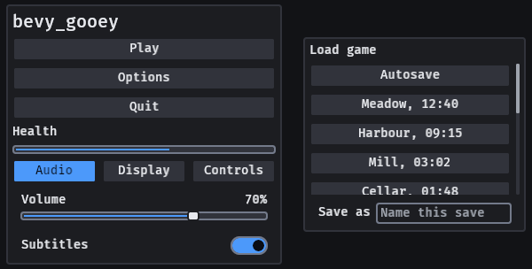
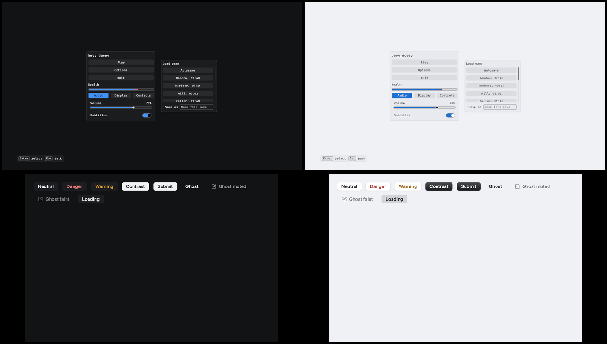
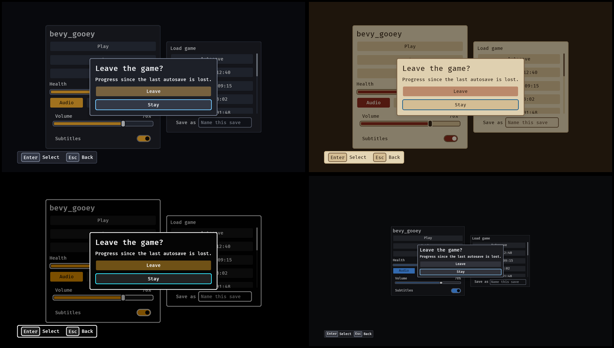
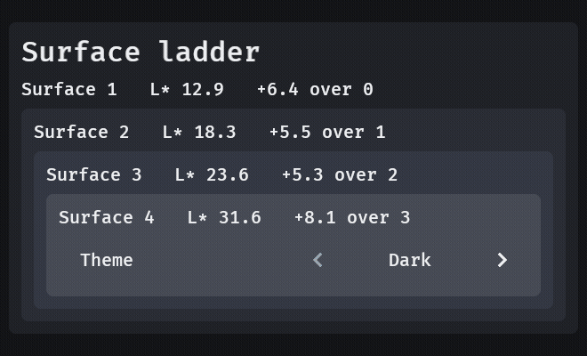
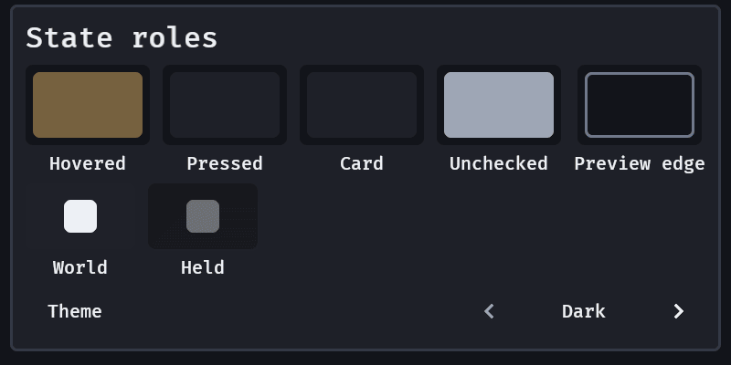
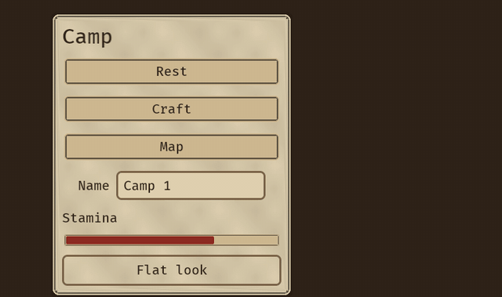

# Skins

`GooeySkin::dark()` is the default; `GooeySkin::parchment()` is the light one and `GooeySkin::high_contrast()` the one for players who need more contrast than WCAG's minimum. Edit the resource live (an options screen, or an editor) and `apply_skin` restyles every widget that frame. With the `serde` feature a skin is RON or any serde format, and a partial file fills the rest from the default, so a project saves only what it changed:

```ron
(accent: Srgba((red: 0.2, green: 0.6, blue: 0.9, alpha: 1.0)), text_scale: 1.25)
```

`GooeySkin::problems()` lists what a skin breaks, and the plugin warns once per problem when the skin changes (it never refuses one):

- text under 4.5:1 contrast against the surface, the raised surface, a hovered button, or the accent (WCAG 2.2, 1.4.3);
- a focus ring under 3:1 against the raised surface (WCAG 2.2, 1.4.11);
- a meter's fill (the accent) under 3:1 against its track, or its frame (`outline`) under 3:1 against the panel, or an off switch's knob (`text_muted`) under 3:1 against its track, or a toast's mark (`accent`, `danger`) under 3:1 against the toast's surface (WCAG 2.2, 1.4.11);
- a `surface_edge` a skin sets under 3:1 against the surface (WCAG 2.2, 1.4.11);
- `min_target` under 24 px (WCAG 2.2, 2.5.8; the default is 44 px);
- a meter too thin to show a fill inside its frame and gap (`meter_height × text_scale` at most 4 × `border`);
- a size that is not finite, or not positive where it must be.

Fonts are yours: set `GooeyFonts { body, heading }`. The default draws Bevy's built-in font when Bevy's `default_font` feature is on.

## Every field

The colours are `background`, `surface`, `surface_raised`, `text`, `text_muted`, `accent`,
`accent_text`, `danger`, `focus_ring`, `outline`, `scrim` and `surface_edge` (`None` is `surface_raised`); the sizes are `text_size`,
`heading_size`, `gap`, `padding`, `radius`, `border`, `meter_height`, `min_target` and `density`; `text_scale` is
the player's option and multiplies text alone. A name ends up in exactly one place: a heading's text
colour is `text` there and nowhere else, because `apply_skin` styles every widget by its `Role`. The
design tokens, `spacing`, `radii`, `type_scale` and `surfaces`, are the [next sections](#design-tokens-and-the-surface-ladder).

`SkinProblem` is the type `problems()` returns; the plugin warns once per problem on a change and never
refuses a skin, so an editor can show a half-finished one.

## Four looks, and a high-contrast one that is checked

`GooeySkin::dark()` (the default), `GooeySkin::parchment()`, `GooeySkin::high_contrast()` and `GooeySkin::tool()` are the presets, and `SkinPreset::{Dark, Parchment, HighContrast, Tool}` names them for a settings row (`SkinPreset::ALL`, `name()`, `skin()`, and `SkinPreset::of(&skin)` for the nearest to a skin). The first three share one set of sizes, so changing the look never moves a layout; [Tool](#compact-density-for-a-tool) is the compact one.

High contrast is the mode Xbox Accessibility Guideline 102 asks a game for: "When enabled, the contrast ratios should equal or exceed 7:1 for all UI elements against their background." Opaque black surfaces, white text and white outlines, an amber accent, a cyan focus ring that no other state uses, and a light red for danger (WCAG advises against red on black, for protanopia). A panel, a tooltip and the legend are framed in white (`surface_edge: Some(white)`; the other presets leave it `None`, which keeps their quiet `surface_raised` frame), so a tooltip over a panel is a card of its own. `GooeySkin::high_contrast_problems()` is `problems()` with every pair held to `ENHANCED_CONTRAST`, 7:1, so a game that writes its own high-contrast skin has the check in one call (it is empty for `high_contrast()` and not for the other two, which meet the 4.5:1 and 3:1 minimums and no more).


*`GooeySkin::high_contrast()`: every text is at least 7:1 on what it is drawn on (15.9:1 on a button), the ring is 13.5:1 on the panel, and a button's fill is 1.3:1 from the panel (the focus ring is the one frame that appears).*

`skin.with_colours_of(&other)` is the skin with `other`'s colours and its own sizes: a player who set 200% text and then asks for high contrast gets both, which is what the [theme row](options.md) does. A game that starts in high contrast because the platform asks (Bevy 0.20 exposes no such setting, so the host reads it) inserts `GooeySkin::high_contrast()` before its first frame.

## Compact density for a tool

A game menu is sized for a thumb at couch distance: 44 px targets and 14 px of padding. A desktop tool has dozens of rows on screen and a mouse at arm's length, so it asks for less room:

```rust
use bevy_gooey::{Density, GooeySkin};
let tool = GooeySkin { density: Density::Compact, ..GooeySkin::dark() };
assert_eq!(tool.target(), 24.0);
assert_eq!(tool.pad(), GooeySkin::dark().padding / 2.0);
```

`Density::Comfortable` (the default) draws `padding` and `min_target` as they are. `Density::Compact` draws half the padding and caps the least target at `MIN_TARGET_PX`, 24 px, which is WCAG 2.2 SC 2.5.8's own floor; `skin.pad()` and `skin.target()` are the values the widgets read. The floor is still checked: `problems()` tests `target()`, so a compact skin whose `min_target` is 20 reports `SkinProblem::TargetTooSmall { px: 20.0 }`, and one whose `min_target` is 44 (the default) is capped to 24 and passes. Nothing else changes: the colours, the focus ring and the keys are the same, and a skin file without the field reads as comfortable.

`GooeySkin::tool()` (`SkinPreset::Tool`, the fourth row of the theme row) is the whole look for a tool: a cool neutral grey with a blue accent (not a game's amber), `Density::Compact`, 14 px text (21 px at 1080p, over Xbox Accessibility Guideline 101's PC minimum of 18 px), a 6 px gap, a 2 px border (the ring's weight, WCAG 2.4.13) and a 4 px radius. A theme-row step writes its colours only, so a player who steps onto Tool keeps their own text size and density; start in the whole preset by inserting `GooeySkin::tool()`. The gallery's settings panel is 294 px tall in it and 520 px in dark. `examples/density` flips `density` with a switch.



*`GooeySkin::tool()`: buttons 24 px high, 2 px frames, the same ring and keys as every look.*

## A skin from three seeds

A host that wants its own look gives a background, a text colour and an accent, and gets the rest:

```rust
use bevy::prelude::*;
use bevy_gooey::{GooeySkin, PaletteSeed};

fn seeded() -> Result<GooeySkin, Vec<bevy_gooey::SkinProblem>> {
    GooeySkin::from_seed(PaletteSeed {
        background: Srgba::hex("#0a0a0a").unwrap().into(),
        text: Srgba::hex("#ededed").unwrap().into(),
        accent: Srgba::hex("#e5484d").unwrap().into(),
    })
}
```

- **Surfaces.** The ladder steps Oklab lightness away from the background: lighter when the text is the lighter seed, darker when it is the darker one. A pure black still gets steps you can see. Each step is at least `ELEVATION_STEP` of L\* past the last, never back toward the background, and keeps the hue of the more colourful seed, so a warm paper stays warm. `surface` is step 1 and `surface_raised` step 3.
- **Derived colours.**
  - Secondary text is held to 4.5:1 on the panel.
  - The outline is the text at the alpha that reaches 3:1.
  - Hover and press are the text at a low alpha over the resting button, the press a `STATE_STEP` past the hover.
  - The accent's words are black or white, whichever reads better on the accent and its hover and press.
  - The focus ring is a neutral blue at 3:1 on every step.
- **Everything else** is `GooeySkin::tool()`'s, a desktop tool's sizes and density.
- **A seed that cannot be read is refused, never adjusted.** The `Err` holds every pair that fails, for example `text on surface` for grey on grey, or `accent_text on …` for a mid red that neither black nor white words reach 4.5:1 on across the accent and its hover and press. A translucent seed is `SkinProblem::TranslucentSeed`.

The derivation is Rune's palette kit, measured and written again here (`docs/research/skin-from-seeds.md`).

## The Desk looks: a desktop tool's neutral skin

`GooeySkin::desk()` and `GooeySkin::desk_light()` are Rune's neutral desktop look.
- The colours are what `GooeySkin::from_seed` derives from `PaletteSeed::desk()` and `desk_light()`: a blue-grey ground, near-white or near-black text and a blue accent.
- The sizes are a desktop tool's: 13 px body text, a 4/8/12/24 spacing scale, 6/8/12 corners, a 1 px frame and compact density at a 24 px least target.
- Rune's elevation and its motion palette come with them.

They are not steps of the theme row, which stays Dark, Parchment, High contrast and Tool. A host that wants them sets the skin:

```rust,ignore
app.insert_resource(GooeySkin::desk());
```

The light Desk's accent is a step deeper than Rune's: Rune's own light blue carries white words at 4.0:1, under this crate's 4.5:1.



## Elevation: shadows as data

`GooeySkin::elevation` holds the shadows for the three heights a surface stands at. Each is a stack of `ShadowLayer { x, y, blur, spread, color }` in CSS terms and logical px, drawn in order.

- `raised` is a panel and a card on the screen.
- `floating` is a popover, a menu, a tooltip and the colour picker.
- `overlay` is a dialog's card, a toast and the command palette (a filtering select's list is the palette's card, so it is an overlay too).

`dark`, `parchment` and `tool` carry Rune's neutral stacks: a 1 px drop blurred 2 px, a 4 px drop blurred 8 px and an 8 px drop blurred 16 px, each with a half-pixel ring. `high_contrast` carries none, because its edges carry depth. A theme step carries the stacks of the look it takes. Bevy draws a shadow under the whole box, so a translucent fill shows a little of it through. A host's own `(Node, Role::Panel)` casts its height's stack too.

```rust,ignore
let mut skin = GooeySkin::dark();
skin.elevation.overlay = vec![ShadowLayer::drop(8.0, 24.0, Color::srgba(0.0, 0.0, 0.0, 0.5))];
```



The blur is CSS's, twice the Gaussian's standard deviation that Bevy's `ShadowStyle::blur_radius` takes (`shadow_sigma`), so `0 8px 24px` reads as it does in a browser. A negative or non-number blur is a `problems()` entry.

## Design tokens and the surface ladder

A tool's chrome stands on a ladder of surfaces (the window's ground, a panel, a row, a field, a card),
and a host that hard-codes each fill finds out late that two of them are one colour. The skin carries
the ladder and checks it, and three scales for the numbers a host's own nodes are built from:

| field | what it is | read with |
|---|---|---|
| `surfaces: Vec<Color>` | flat fills, lowest first (five in every preset) | `skin.surface_at(n)`, `surface(n)`, `Role::Surface(n)` |
| `spacing: [f32; 6]` | gaps and paddings, logical px, smallest first | `skin.space(step)` |
| `radii: [f32; 3]` | corner radii | `skin.corner(step)` |
| `type_scale: [f32; 5]` | text sizes before `text_scale` | `skin.type_size(step)`, which multiplies by `text_scale` |

A step past the end is the last. Each preset's own `gap`, `padding`, `radius`, `text_size` and
`heading_size` are entries of its scales (a test holds it), so what a host builds from the tokens and
what the widgets draw share one rhythm; `GooeySkin::tool()` has tighter scales than the other three.

```rust,ignore
// Nested cards, each a step above the one it stands in, on the skin's own tokens.
commands.spawn((
    Role::Surface(1),
    Node {
        padding: UiRect::all(Val::Px(skin.space(3))),
        border_radius: BorderRadius::all(Val::Px(skin.corner(1))),
        ..default()
    },
    children![(Role::Surface(2), Node::default(), children![label("A row")])],
));
```

`surface(n)` is the same node with a column and nothing else, for a surface that needs no padding of its
own (a bundle cannot carry two `Node`s, so a padded one names `Role::Surface` and its own `Node`, as
above). A surface draws its fill and nothing else: no padding, no frame, no corner.

**The ladder is measured.** `problems()` reports `SkinProblem::ElevationStep { lower, upper, delta_l }`
for two adjacent surfaces that differ by less than `ELEVATION_STEP`, ΔL\* 2.0 in CIE L\* (`cie_lightness`
is the maths, in `model`): about the smallest lightness difference the eye can tell apart on a large flat
field, and a comfortable step is about 4. WCAG's contrast ratio is the wrong instrument down in the
blacks (its `+0.05` flare term makes two clearly different dark greys and two identical ones both score
about 1.0), which is why this is its own check. Direction does not matter, so a recessed well below its
neighbour is a valid step; a single surface is a valid ladder; an empty one, a spacing or corner scale
with a negative, non-finite or falling step and a type scale with a non-positive one report
`SkinProblem::BadScale { field }`. The four presets' steps are at least ΔL\* 5 apart; the alpha of a
surface is ignored. The check is about fills telling apart, not about text: the crate checks `text` against
`surface` and `surface_raised`, not against every step (parchment's step 0 is the dark window behind its
cream panels, and a host that puts text on a step checks that pair itself, at 7:1 in a high-contrast skin).
A theme step (`with_colours_of`) brings the ladder with the colours and keeps the player's scales.



*`examples/ladder`: the steps in dark are L\* 12.9, 18.3, 23.6 and 31.6 over a ground of 6.5; the labels are the ladder read back through `cie_lightness`.*

## State roles: hover, pressed, held, card

A host that builds its own rows, chips and overlays from the skin needs the interaction states too, so
the skin owns them. Seven colours are `Option<Color>` fields of `GooeySkin` (`None` in every preset),
each with an accessor that answers from the nearest field when the skin sets none, so a skin that sets
none of them still answers every role:

| field | accessor / `Role` | `None` is | what it is |
|---|---|---|---|
| `hover` | `hovered()` / `Role::Hovered` | `surface_raised` a third of the way to `accent` | a row, chip or field under the pointer; **every hovered button of the crate draws it too** |
| `pressed` | `pressed()` / `Role::Pressed` | `solid_surface()` | a control with the pointer down, sunk below hover (the crate's own pressed button stays `accent`) |
| `held` | `held()` / `Role::Held` | `text` faded toward `held_ground()` by `held_fade` | a world gizmo or glyph while the key that asks the world to step back is held |
| `held_ground` | `held_ground()` / `Role::HeldGround` | `solid_surface()` faded by the same `held_fade` | the ground that steps back with it |
| `unchecked` | `unchecked()` / `Role::Unchecked` | `text_muted` | the mark of a thing not judged yet |
| `card` | `card()` / `Role::Card` | `solid_surface()` | the card the scrim leaves lit while it holds the rest back |
| `preview_edge` | `preview_edge()` / `Role::PreviewEdge` | `outline` | the edge of a row's preview box (a border, no fill) |

`held_fade` (0.6, from 0 to 1) is one number for both held colours, so a held ground and a held glyph
"come off one fade" and compose. A role draws its colour on a node of your own (`(Role::Pressed,
Node { .. })`) and nothing else; swap the role as the pointer goes down and the node is restyled the next
frame. Where no role draws it (a gizmo, a sprite), read the accessor.

```rust
use bevy::prelude::*;
use bevy_gooey::{GooeySkin, Role};

fn row(mut commands: Commands) {
    // A host's row: `Role::Hovered` under the pointer, `Role::Pressed` with it down.
    commands.spawn((Role::Hovered, Node { height: Val::Px(44.0), ..default() }));
}

fn gizmo_colour(skin: &GooeySkin, key_held: bool) -> Color {
    if key_held { skin.held() } else { skin.text }
}
```

**What `problems()` checks.** `text` on `pressed` and on `card` at the text minimum, `unchecked` and
`preview_edge` on the panel at the 3:1 graphic minimum (7:1 in `high_contrast_problems()`), and
**pressed against hovered by a lightness step**, `STATE_STEP`, ΔL\* 4: WCAG 1.4.11 asks no contrast of two
states that do not appear side by side, only that each keeps the contrast of what is drawn on it, so the
check is whether a reader can tell them apart. A pressed fill at hover's lightness is
`SkinProblem::Indistinguishable { pair, delta_l, needed }`. A `held_fade` outside 0 to 1 is
`SkinProblem::BadSize`. Held colours are not contrast-checked: a held colour is stepped back on purpose.
A theme step (`with_colours_of`) replaces them with the look's own, as it does every colour.



*`examples/states`: every swatch is a `Role` on a plain node; the glyphs are read from `text` and `held()`.*

## Your own named colours

A tool has more semantic colours than a skin's fixed fields: a suggestion ink, a map's grid line, a problem banner's fill, a rarity. `GooeySkin::tones` carries them by name, so a skin file lists them, a theme can change them and "the UI's colours are the skin" holds:

```rust
fn setup(mut commands: Commands, mut skin: ResMut<GooeySkin>) {
    skin.tones.insert("suggest".into(), Color::srgb(0.62, 0.86, 0.55));
    skin.tones.insert("banner".into(), Color::srgb(0.30, 0.10, 0.10));

    // A node drawn with a tone: restyled in the frame the skin changes.
    commands.spawn((Role::Tone("banner"), Node { padding: UiRect::all(Val::Px(8.0)), ..default() }));

    // The pairs your own chrome relies on, checked like the crate's: (label, ink, ground, needed).
    // Each name is a tone or one of the skin's own colours ("text", "surface", "accent", ...).
    let problems = skin.tone_problems(&[
        ("suggest on surface", "suggest", "surface", 4.5),
        ("text on banner", "text", "banner", 4.5),
    ]);
    assert!(problems.is_empty(), "{problems:?}");
}
```

- **`skin.tone("suggest")` is `Some(color)`, and an unknown name is `None`**, never a stand-in colour; names are case-sensitive and not translated. Every preset has no tones, so a skin with none is valid, and `problems()` does not look at them (it cannot know which pairs you draw).
- **`Role::Tone(name)` is a fill and nothing else**: give the node its own `Node`. A name the skin lacks draws no fill (transparent), including after a skin swap that drops the tone.
- **`tone_problems`** returns one `SkinProblem::LowContrast { pair: label, .. }` for each declared pair under its ratio (4.5 for text, 3.0 for a graphic, `ENHANCED_CONTRAST` for a high-contrast look of your own) and one `SkinProblem::UnknownTone { name }` for a name that is neither a tone nor a skin colour, because a pair that cannot be read must not pass. The label is yours because `LowContrast::pair` is a `&'static str`. Alpha is ignored, as everywhere else: declare the opaque ground a translucent tone sits on.
- **A theme step leaves them.** `skin_preset("Theme")` writes the preset's own colours and keeps `tones`, which are the host's; a preset has none to give. With the `serde` feature they are a `tones: {"suggest": Srgba(..)}` map in a skin file.

## A skin for one subtree

`SkinScope(skin)` on any node styles that node and everything below it from `skin` and not from the
`GooeySkin` resource, so a preview of a theme, a tool's own chrome or a vendor's window stands next to the
rest of the interface in another look:

```rust,ignore
commands.spawn((panel(), SkinScope(GooeySkin::parchment()), children![button("Play")]));
```

- **The nearest scope wins.** A widget takes the scope on itself or on its nearest ancestor; a scope nested
  in another shadows it, and a widget under none is styled from the resource.
- **It is the whole skin.** Sizes and `text_scale` are the scope's, so a preview at 200% text, or a compact
  panel, is a scope too; `GooeyFonts` stays global (a font is an asset the host loads). The player's own
  text size is the resource's: a scope that should follow it copies `text_scale` itself.
- **A change touches the subtree and nothing else.** Adding, changing or removing a scope restyles every
  widget below it in the same frame (removed: from the next scope up, or the resource), and so does moving
  a widget under or out of one; a changed resource restyles the unscoped and leaves a scoped widget as it
  is. An idle frame writes nothing, and with no scope anywhere the cost is one empty-query check.
- **A scope is checked like a skin.** One that fails `problems()` logs a warning per problem when it
  changes and is applied anyway.
- **A toast stack and the legend are not below the node that spawned them.** Put a `SkinScope` on them to
  have them follow a scope; a tooltip box is a child of its widget and follows its widget.

`cargo run --release --example scope` shows the options panel in the player's skin next to a preview panel
in parchment: Theme and Text size change the left one, the right one stays, and Enter on its button takes
the scope off so it joins the left one.

## Loading one

`GooeySkin` and `UiScaleSettings` derive serde under the `serde` feature, and both are
`#[serde(default)]`, so a project's file holds only what it changed:

```ron
(accent: Srgba((red: 0.2, green: 0.6, blue: 0.9, alpha: 1.0)), text_scale: 1.25)
```

A game sets the resource at start-up (`app.insert_resource(GooeySkin::parchment())`); Grimoire reads a
project's `family/bevy_gooey.ron` into the same type while the editor runs.

## Art frames: `GooeyFrames`

A skin is colours, and a game with painted art wants its panels and buttons drawn from that art. `GooeyFrames` (a resource, like `GooeyFonts`: images are the game's assets, not saved data) holds a nine-slice `Frame { image, slice }` for every `panel()` (a dialog's too), every `button()` that has a fill at rest (a ghost button stays flat) as `field`, every text field, as `meter`, the track of every `meter()` and `progress()` (the art under the fill, which keeps the skin's colour) and, as `popup`, what floats: tooltips, popovers, menu panels, the command palette and toasts. The struct is `#[non_exhaustive]`, so a role added later is not a breaking change: assign the fields you have art for on the resource.

```rust
fn setup(mut frames: ResMut<GooeyFrames>, assets: Res<AssetServer>) {
    frames.panel = Some(Frame::new(assets.load("ui/panel.png"), 12.0));
    frames.button = Some(Frame::new(assets.load("ui/button.png"), 8.0));
    frames.popup = Some(Frame::new(assets.load("ui/popup.png"), 8.0));
}
```

The skin's colours tint the art: the fill each state would have is the tint, so rest, hover, press, disabled, a `SkinScope` and a fade all multiply the image. Draw the art in light neutrals (near white) and the skin does the colour; art with its own colours is tinted toward the skin's. The art is a layer under the widget's children (`FrameLayer`, found by `Framed(entity)` on the widget) because Bevy draws an image inside a node's padding; layout is the flat look's, the focus ring (a button's border) is drawn over the art, and an outline (a panel's, a tooltip's, a menu's) is dropped, the art has its own edge. Take a field back to `None` and the flat fill returns. A widget that already holds an image of your own is left alone. Corner size is in image pixels and is not scaled by `UiScale`. `field` frames text fields: Bevy measures the field itself as a leaf, which a child layer would collapse, so the art is a layer of its cell behind it and the field's border (outline and focus ring) stays over the art. Tabs and toggle groups are not framed yet. `examples/frames.rs` draws its own art in code; research: `docs/research/frames.md`.



