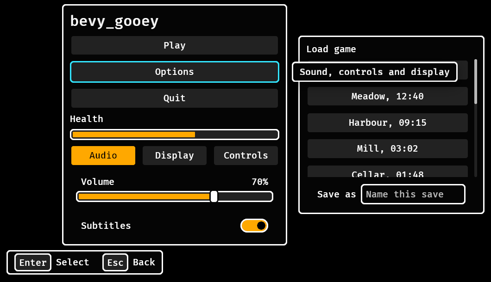

# Skins

`GooeySkin::dark()` is the default; `GooeySkin::parchment()` is the light one and `GooeySkin::high_contrast()` the one for players who need more contrast than WCAG's minimum. Edit the resource live (an options screen, or an editor) and `apply_skin` restyles every widget that frame. With the `serde` feature a skin is RON or any serde format, and a partial file fills the rest from the default, so a project saves only what it changed:

```ron
(accent: Srgba((red: 0.2, green: 0.6, blue: 0.9, alpha: 1.0)), text_scale: 1.25)
```

`GooeySkin::problems()` lists what a skin breaks, and the plugin warns once per problem when the skin changes (it never refuses one):

- text under 4.5:1 contrast against the surface, the raised surface, a hovered button, or the accent (WCAG 2.2, 1.4.3);
- a focus ring under 3:1 against the raised surface (WCAG 2.2, 1.4.11);
- a meter's fill (the accent) under 3:1 against its track, or its frame (`outline`) under 3:1 against the panel, or an off switch's knob (`text_muted`) under 3:1 against its track, or a toast's mark (`accent`, `danger`) under 3:1 against the toast's surface (WCAG 2.2, 1.4.11);
- a `surface_edge` a skin sets under 3:1 against the surface (WCAG 2.2, 1.4.11);
- `min_target` under 24 px (WCAG 2.2, 2.5.8; the default is 44 px);
- a meter too thin to show a fill inside its frame and gap (`meter_height × text_scale` at most 4 × `border`);
- a size that is not finite, or not positive where it must be.

Fonts are yours: set `GooeyFonts { body, heading }`. The default draws Bevy's built-in font when Bevy's `default_font` feature is on.

## Every field

The colours are `background`, `surface`, `surface_raised`, `text`, `text_muted`, `accent`,
`accent_text`, `danger`, `focus_ring`, `outline`, `scrim` and `surface_edge` (`None` is `surface_raised`); the sizes are `text_size`,
`heading_size`, `gap`, `padding`, `radius`, `border`, `meter_height` and `min_target`; `text_scale` is
the player's option and multiplies text alone. A name ends up in exactly one place: a heading's text
colour is `text` there and nowhere else, because `apply_skin` styles every widget by its `Role`.

`SkinProblem` is the type `problems()` returns; the plugin warns once per problem on a change and never
refuses a skin, so an editor can show a half-finished one.

## Three looks, and a high-contrast one that is checked

`GooeySkin::dark()` (the default), `GooeySkin::parchment()` and `GooeySkin::high_contrast()` are the presets, and `SkinPreset::{Dark, Parchment, HighContrast}` names them for a settings row (`SkinPreset::ALL`, `name()`, `skin()`, and `SkinPreset::of(&skin)` for the nearest to a skin). They share one set of sizes, so changing the look never moves a layout.

High contrast is the mode Xbox Accessibility Guideline 102 asks a game for: "When enabled, the contrast ratios should equal or exceed 7:1 for all UI elements against their background." Opaque black surfaces, white text and white outlines, an amber accent, a cyan focus ring that no other state uses, and a light red for danger (WCAG advises against red on black, for protanopia). A panel, a tooltip and the legend are framed in white (`surface_edge: Some(white)`; the other presets leave it `None`, which keeps their quiet `surface_raised` frame), so a tooltip over a panel is a card of its own. `GooeySkin::high_contrast_problems()` is `problems()` with every pair held to `ENHANCED_CONTRAST`, 7:1, so a game that writes its own high-contrast skin has the check in one call (it is empty for `high_contrast()` and not for the other two, which meet the 4.5:1 and 3:1 minimums and no more).



*`GooeySkin::high_contrast()`: every text is at least 7:1 on what it is drawn on (15.9:1 on a button), the ring is 13.5:1 on the panel, and a button's fill is 1.3:1 from the panel (the focus ring is the one frame that appears).*

`skin.with_colours_of(&other)` is the skin with `other`'s colours and its own sizes: a player who set 200% text and then asks for high contrast gets both, which is what the [theme row](options.md) does. A game that starts in high contrast because the platform asks (Bevy 0.20 exposes no such setting, so the host reads it) inserts `GooeySkin::high_contrast()` before its first frame.

## A skin for one subtree

`SkinScope(skin)` on any node styles that node and everything below it from `skin` and not from the
`GooeySkin` resource, so a preview of a theme, a tool's own chrome or a vendor's window stands next to the
rest of the interface in another look:

```rust,ignore
commands.spawn((panel(), SkinScope(GooeySkin::parchment()), children![button("Play")]));
```

- **The nearest scope wins.** A widget takes the scope on itself or on its nearest ancestor; a scope nested
  in another shadows it, and a widget under none is styled from the resource.
- **It is the whole skin.** Sizes and `text_scale` are the scope's, so a preview at 200% text, or a compact
  panel, is a scope too; `GooeyFonts` stays global (a font is an asset the host loads). The player's own
  text size is the resource's: a scope that should follow it copies `text_scale` itself.
- **A change touches the subtree and nothing else.** Adding, changing or removing a scope restyles every
  widget below it in the same frame (removed: from the next scope up, or the resource), and so does moving
  a widget under or out of one; a changed resource restyles the unscoped and leaves a scoped widget as it
  is. An idle frame writes nothing, and with no scope anywhere the cost is one empty-query check.
- **A scope is checked like a skin.** One that fails `problems()` logs a warning per problem when it
  changes and is applied anyway.
- **A toast stack and the legend are not below the node that spawned them.** Put a `SkinScope` on them to
  have them follow a scope; a tooltip box is a child of its widget and follows its widget.

`cargo run --release --example scope` shows the options panel in the player's skin next to a preview panel
in parchment: Theme and Text size change the left one, the right one stays, and Enter on its button takes
the scope off so it joins the left one.

## Loading one

`GooeySkin` and `UiScaleSettings` derive serde under the `serde` feature, and both are
`#[serde(default)]`, so a project's file holds only what it changed:

```ron
(accent: Srgba((red: 0.2, green: 0.6, blue: 0.9, alpha: 1.0)), text_scale: 1.25)
```

A game sets the resource at start-up (`app.insert_resource(GooeySkin::parchment())`); Grimoire reads a
project's `family/bevy_gooey.ron` into the same type while the editor runs.
