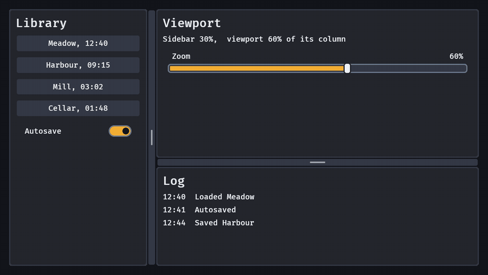

# Split panes

`split(axis, first, second)` is two panes with a divider between them that the player moves: a docked layout, an inventory beside a map, a log under a viewport. The panes' content is any bundle each; a `panel()` fills its pane on both axes. A split fills its parent, so stand it in a node of the size you want (a `screen()` is the window):

```rust
fn dock(mut commands: Commands) {
    commands.spawn((
        screen(),
        children![(
            split(
                SplitAxis::Horizontal,
                (panel(), children![heading("Library"), button("Meadow, 12:40")]),
                // A split in a pane is a nested split, with its own state.
                (
                    split(
                        SplitAxis::Vertical,
                        (panel(), children![heading("Viewport")]),
                        (panel(), children![heading("Log")]),
                    ),
                    SplitFraction(0.7),
                    SplitMin::new(140.0, 100.0),
                ),
            ),
            SplitFraction(0.28),
            SplitMin::new(240.0, 360.0),
            observe(|change: On<ValueChange<f32>>| info!("the sidebar is at {}", change.value)),
        )],
    ));
}
```



- `SplitAxis::Horizontal` puts the panes side by side (a vertical divider, moved with Left and Right); `SplitAxis::Vertical` stacks them (a horizontal divider, moved with Up and Down).
- **The state is a fraction.** `SplitFraction(f32)` on the split is the first pane's share of the room the divider leaves (the split's length on its axis less the divider's), 0.5 until you insert another in the same tuple. It is plain data (serde with the `serde` feature): save it with the player's other settings. Set it from code and the panes follow in the same frame with no event; a player's change is one `ValueChange<f32>` on the split, `is_final` false while a drag goes on and true at its end and for every key. A fraction keeps the layout through a window resize and a change of UI scale.
- **Minimums.** `SplitMin { first, second }` in logical pixels (none by default). A drag, a key or Home and End never leave a pane smaller than its minimum, and a window too small for both takes the room from the second pane first, down to nothing, and then from the first; the stored fraction is the player's preference and stays as it was, so the layout is back when the window grows. A pane's content that is wider than the pane is clipped, never widens it.
- **The divider** is a channel 24 px wide (`MIN_TARGET_PX`, the least WCAG 2.2 asks of a pointer target) on the list rail's colour with a grip in the middle: the muted text colour (3:1 against the rail in every preset), the text colour under the pointer or with focus, the accent while held, the focus ring while it has focus. It takes the resize cursor. A drag of `d` pixels changes the fraction by `d` over the room, whatever the UI scale.
- **Keys.** With the divider focused (Tab reaches it, a press on it focuses it), the arrows along the axis step it 16 px (`SPLIT_KEY_STEP_PX`, a held key repeats), Home and End take the first pane to its smallest and largest, and Enter collapses the first pane to its minimum or gives it back, as the ARIA window splitter pattern says. The other arrows move focus on. The D-pad steps it along the axis (held, it repeats like a slider's) and South collapses and restores it ([`split_by_pad`](../../src/split.rs)).
- **Without a drag.** WCAG 2.5.7 asks that a drag has a way that is not one: a double click on the divider collapses and restores the first pane. A game that needs every size by pointer alone puts its own step buttons beside the split and sets `SplitFraction`.
- `InteractionDisabled` on the divider entity (the one with `SplitDivider`) fixes the layout: it still takes focus and moves nothing.
- `Split`, `SplitDivider` and the panes are what `split()` spawns; the panes carry `Role::SplitPane` and the divider `Role::SplitDivider`, and the look is `apply_skin`'s like any widget's.
- `model::split_mins`, `split_clamp` and `split_drag` are the engine-free maths: a fraction held to the minimums in a room, and where a drag leaves it.
- A split does not remember a pane's content when a pane is collapsed (the content stays, clipped), does not persist its state by itself, and has no accessibility node yet: Bevy's headless widgets give a separator none.
- **A drag that does nothing says why.** The divider's handlers log at `debug` level (target `bevy_gooey::split`, for example `RUST_LOG=bevy_gooey::split=debug`) each condition that makes them stand still: a divider or split missing the components they read (`ChildOf`, `SplitDivider`, `ComputedNode`, `SplitFraction`, `SplitMin`), a drag by a button other than the primary one, a disabled divider, a drag that never began on it, and each move's pointer distance, the room and the fraction before and after. A drag whose pointer position never changes between press and move has distance zero and moves nothing. The same drag is tested for an interface drawn into an image (the pointer's target is the image, at its own scale factor, under a UI scale), one move a frame and minimums of 96 px.

## A collapsed pane peeks


Collapse the first pane (Enter on the divider, South, a double click) and it does not have to be gone: rest the
pointer on the divider (or the sliver of pane the minimum leaves) for `SplitPeekSettings::delay_seconds` (0.05 s,
Rune's sidebar peek) and the pane slides out over the second pane as wide as a restore would make it, with the
`floating` shadow, **without moving the second pane by a pixel** (it is out of the flow; the divider moves to its
far edge, above it, and the second pane keeps the room it had). It stays while the pointer is on it, the divider or
the edge, and slides back when the pointer has been off them for `grace_seconds` (0.15 s) or Escape is pressed
(WCAG 1.4.13: hoverable, persistent, dismissible). Enter, South or a double press on the divider docks it where
it floats (no glide: it is already that wide), and a drag, an arrow, Home, End or the D-pad on the divider docks it
first and goes on from there. A visible focus inside the collapsed pane peeks it too (Tab or an arrow into it: a keyboard or pad player sees
the widget they land on, where it was clipped before); the divider's own focus does not, or a pane collapsed with
Enter on it would come straight back. A pointer that was already on the edge when the pane collapsed has to leave
and come back before it peeks. `SplitPeek::is_open` says whether one floats; `SplitPeekSettings { enabled: false, .. }`
turns it off. Under reduced motion it fades in with no slide and goes at once, and with no motion it comes and goes
in a frame. A split that is not collapsed never peeks. (`docs/research/split-peek.md`)
