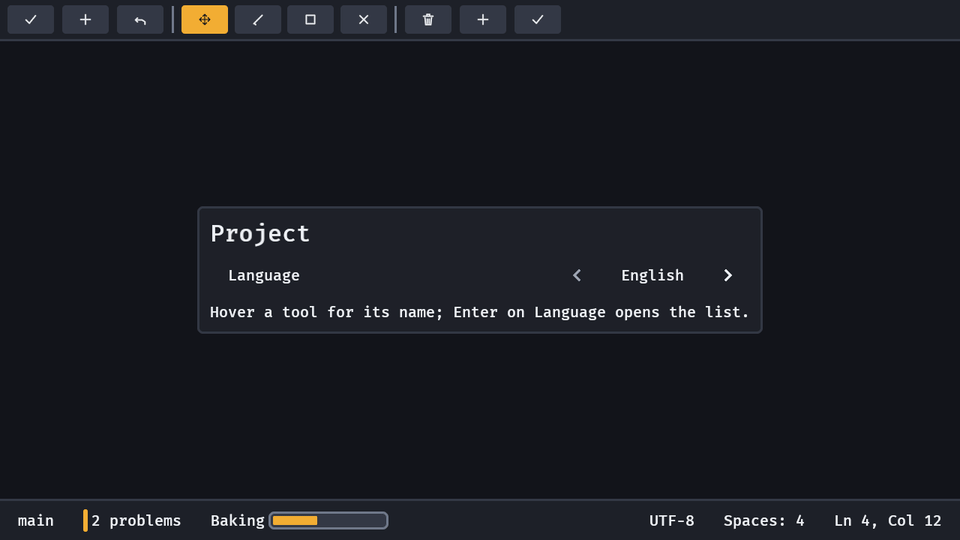
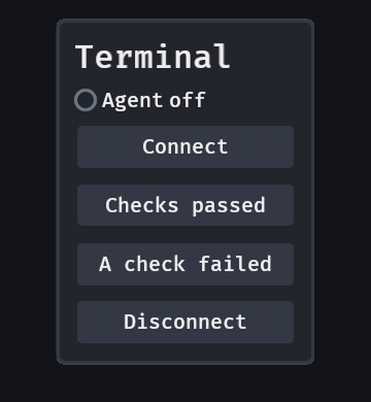

# Status bar

A tool shows its workspace's state on the left of a bar along the foot of the window and the context's on the right, always visible. `status_bar(left, right)` is that bar, `status_item(text)` an entry in it.

```rust
fn status(mut commands: Commands) {
    commands.spawn(status_bar(
        children![
            (status_item("main"), Tooltip::new("Current branch")),
            (
                status_item("2 problems"),
                StatusKind::Warning,
                observe(|_: On<Activate>| info!("open the problems list")),
            ),
            status_progress("Baking", 0.4),
        ],
        children![
            (status_item("UTF-8"), StatusPriority(10)),
            (status_item("Ln 4, Col 12"), StatusPriority(200)),
        ],
    ));
}
```



- **Left and right.** The left group grows and starts at the bar's start; the right is pushed to its end. Put the workspace's state (branch, problems, sync) on the left and the file's (encoding, position) on the right, as VS Code's guidelines do.
- **`status_item(text)`** is a Bevy `Button` a target high: Enter, Space, South and a click send `Activate`; hover and visible focus light it like a menu title. It takes a `Tooltip` like any widget. Its words are one line in the text colour at 4.5:1 in every look.
- **`StatusKind`** (`Info` by default, `Warning`, `Error`) draws a mark at the item's start, a bar in the accent or the danger colour. The words never change colour, and the mark is a shape as well as a hue. Change the component and the mark changes in the same frame.
- **`StatusPriority(u8)`** (default 128) decides what hides when the window is too narrow: the lowest first, the right group's before any of the left's, the later of equal priorities first. A hidden item (`Overflowed`) keeps its width and returns when the room does; focus on an item that hides is let go. A bar never wraps.
- **`status_progress(text, fraction)`** is an item that also shows a short `progress` bar (8 body text sizes wide, no words line) after its text; change its `Progress` to move it.

`examples/tools.rs` shows it; `GOOEY_KEYS="width:760"` narrows the bars.

## An LED: `led`

`led("Agent", LedState::Live)` is a glowing dot with its label and the state in words: write `Led(LedState::Busy)` on the row and the dot and the word follow in the next frame. Each state has its own silhouette, so colour is never the only signal (WCAG 1.4.1): `Off` a hollow ring, `Live` a disc in `GooeySkin::live()` (the danger colour's lightness and chroma at a green hue) with a steady glow, `Busy` a rounded square in `warning()` whose glow pulses (1.2 s; steady under `MotionSettings::reduced()` and `off()`), `Failed` a diamond in `danger`. No new skin colour is needed, and all of them hold 3:1 on the panel in every preset. What "live" means is the game's; the widget draws the state it is given, and a settled LED writes nothing. Research: `docs/research/led.md`; `examples/led.rs`.


