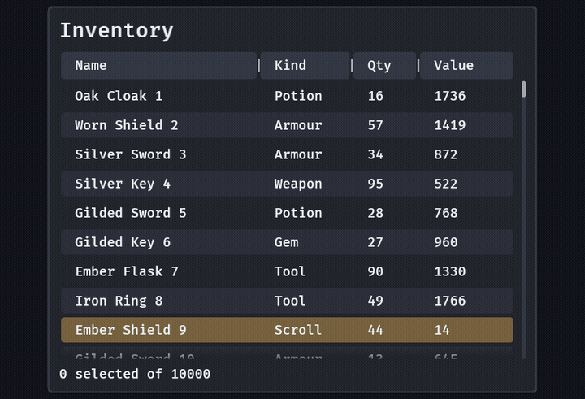

# Tables

`table(columns, rows)` is a header over a scrolling body of rows, and the body is **virtualized**: ten thousand rows cost about a dozen entities. Use it for an inventory, a save list, a history, a log: anything that is long, has the same shape on every row and wants sorting.

```rust
fn inventory(mut commands: Commands) {
    let rows: Vec<Vec<String>> = (0..10_000)
        .map(|i| vec![format!("Item {i}"), format!("{}", i * 7 % 100)])
        .collect();
    commands.spawn((
        panel(),
        children![(
            table([Column::new("Name").width(14.0), Column::new("Qty").width(6.0)], rows),
            SelectMode::Multi,
            observe(|sort: On<SortBy>| info!("sorted by column {}", sort.column)),
            observe(|selected: On<ValueChange<TableSelection>>| {
                info!("{} rows selected", selected.value.len());
            }),
            observe(|opened: On<RowActivated>| info!("opened row {}", opened.key)),
        )],
    ));
}
```



- **The rows are yours.** A `RowSource` is `len`, `cell(row, column) -> Cow<str>` and, if you need them, `key(row)` (the row's identity, its index by default) and `compare(column, a, b)` (the order, the cells' text in natural order by default: "Item 2" before "Item 10"). `Vec<Vec<String>>` is one. The table asks for what is in view and keeps no copy.
- **Virtualized.** Every row is one height (a button's, `GooeySkin::table_pitch`), so the table needs no measuring: the viewport is as tall as all the rows, the rows in view and one more are real entities, and the rest are the room above and below them. However the table scrolls it has at most `rows in view + 2` row entities (`TableRows`, 8.5 by default: `(table(..), TableRows(12.0))`). A cell is one line, cut at its column.
- **Columns.** `Column::new("Name").width(14.0)` is 14 body text sizes wide, so it keeps its characters per cell at any text size; `.unsortable()` makes its header a button that sorts nothing. The last column also takes the room that is left. The player drags a column's right edge or, with the header focused, presses Ctrl and Left or Right (16 px a press, for WCAG 2.5.7); `TableWidths` holds what they chose, as data to save, and a column never gets under 3 text sizes.
- **Sorting.** A click, Enter or Space on a sortable header sorts by it, ascending first and turned round by each next click, with a chevron beside the title: `TableSort { column, descending }` is the state and `SortBy` is sent once for the player's choice. Set `TableSort` yourself to start sorted or to sort from code (no event). A new sort scrolls to the cursor row, or to the top.
- **Changing the rows.** Change them through the component: `table.source_mut::<MyRows>()` or `table.set_source(..)`. The table sorts the new rows the way they were sorted and keeps the row that was at the top of the view at the same place, by `key`: rows inserted above it do not move what the player is reading. A selected row that is gone leaves the selection (no event: it was your change), and a cursor row that is gone moves to where it stood.
- **Selection** is by `key`, so it follows a row through a sort. `SelectMode::Single` (the default), `Multi` or `None`. A click selects a row; in `Multi` Ctrl and a click toggles it and Shift and a click takes the range from the last click. The player's change is one `ValueChange<TableSelection>` with the whole selection; `TableSelection` is plain data a game may set.
- **Keys.** The table is one tab stop with a cursor row (`TableCursor`, the ringed row), as a list box is: Up and Down, Page Up and Page Down (the rows in view less one), Home and End (the first and last row of the *data*, not of the rows drawn) move it and select the row; Ctrl and a key moves the cursor and leaves the selection; Shift and an arrow extends it in `Multi`; Space selects the row (toggles it in `Multi`), Ctrl and A selects every row, Enter or a double click opens the row (`RowActivated`). Typing goes to the next row whose first column starts with what was typed within a second (as a tree's typing does) and scrolls it into view. Up from the first row and Down from the last move focus on, so a pad can leave. On a pad: the D-pad (held to repeat), the triggers for pages, South to open.
- **Look.** Rows have no fill at rest and a quiet band on every second one (never the only mark of anything), the hovered fill under the pointer, the accent with inverted text while selected and the focus ring on the cursor row while the table has focus the player can see. Headers are buttons. Every word is checked in all four looks.
- **Where it stops.** No horizontal scroll (columns wider than the table are cut), no row taller than one line, no cell widgets: a game that needs a button in a row puts its own over the table. `TableRow` on a row's entity says which row of the data it shows now (for a tooltip or a context menu); never keep the entity, the table reuses it as it scrolls.
