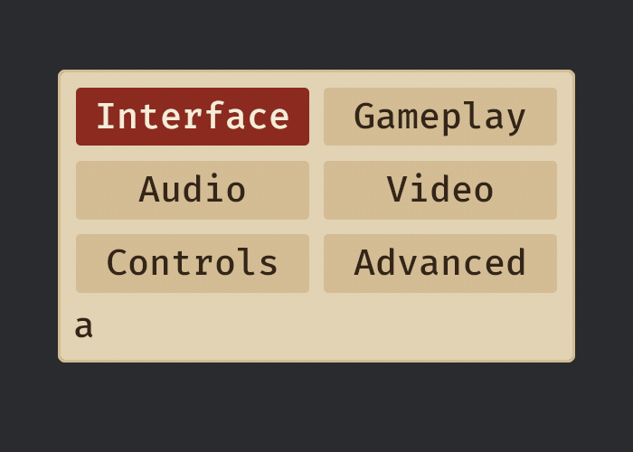

# Tabs

`tabs(labels, selected, children![tab_page(..), ..])` is a strip of one- or two-word labels over pages of widgets, one page shown at a time: the i-th label opens the i-th `tab_page`. It is how a settings screen of more than a handful of rows fits (Audio, Display, Controls):

```rust
fn settings(mut commands: Commands) {
    commands.spawn((
        panel(),
        children![
            heading("Settings"),
            (
                tabs(
                    ["Audio", "Display"],
                    0,
                    children![
                        tab_page(children![slider("Volume", 0.7, 0.0..=1.0), toggle("Subtitles", true)]),
                        tab_page(children![choice("Quality", ["Low", "Medium", "High"], 1)]),
                    ]
                ),
                observe(|c: On<ValueChange<usize>>| info!("page {}", c.value)),
            ),
        ],
    ));
}
```


*`examples/gallery`: the three tabs of its settings, turned by Right on a focused tab and by the bumper's keys from inside a page. The panel never changes size.*

## How a player turns a page

| input | what it does |
|---|---|
| a click on a tab | selects it |
| Left and Right on a focused tab | step to the previous or next tab, wrapping at the ends; focus goes with the selection (Bevy's own, so the page needs no Enter) |
| Home and End on a focused tab | the first and the last tab |
| the D-pad's Left and Right on a focused tab | the same as Left and Right |
| **LB and RB**, or **Ctrl+PageUp and Ctrl+PageDown** | the previous and next tab from **anywhere in the widget**, wrapping |
| Up from a widget in the page | focus goes to the **selected** tab, even when another is nearer |
| Down from a tab, or Tab | into the page |

LB and RB are the pad's `LeftTrigger` and `RightTrigger` (Bevy's names for the bumpers); the pad's lower
triggers stay the list's. Xbox's guideline 112 asks that "RB and LB for moving through tabs" be the same
on every screen, and the player's hand is on the page, so a pad player never goes back up to the strip.
The bumpers act on the tabs widget the focus is in, or, with focus beside it (a Back button), on the only
tabs widget in view in the focus's scope (an open `dialog` is its own scope); with none or two to choose
from they do nothing. Show your player the bumper prompt: not every game uses the bumpers (XAG 106).

## What it looks like, and what stays still

- The selected tab is filled `accent` with `accent_text` on it; the others are a button's grey with the
  text colour, so every tab reads at full contrast and the selected one differs by fill luminance and by
  text colour, not by hue alone (NN/g: "Use at least two selection indicators"). The strip is a row of
  equal columns as wide as the widest label, `min_target` high, with a button's focus ring, and the panel
  it stands in grows to fit the labels, never squeezing one.
- **A strip that does not fit wraps.** The strip is a grid of as many equal columns as the room it is
  given holds -- counted from the widest label, its own padding and the gap between tabs, and never more
  than the tabs there are -- so at 200% text in a narrow panel a six-tab strip lays out two columns by
  three rows instead of running past the panel's edge. Every cell in a row is the same width, which is
  what a wrapping flex row could not do (its cells came out `[312, 284]` px) and `auto-fit` could not
  either (taffy collapsed it to one column). `flow_strips` counts the columns and writes the grid only
  when the count changes, so a settled strip writes nothing.

  
- **A selection indicator slides.** Changing the lit option springs one accent node from the old option's rect to the new one's on `motion.snappy` instead of swapping two fills; a change mid-flight turns round from where it is drawn. It is hidden at rest, so the options look as ever; reduced motion and no motion light the option at once, and so does a hop between two rows of a wrapped strip (the puck never crosses the gutter between rows). `SelectionIndicator` is its component and `Indicating` the mark on a strip and its options while it travels.
- **Every page takes the room of the largest**, so turning a page moves nothing: not the strip, not the
  panel round it, and the player's hand does not follow a moving target. The price is blank room under a
  short page. The pages not shown are hidden, which keeps their room, hides them from the pointer and
  takes their widgets out of Tab and the arrows.
- Both skins are one family: in the dark skin the lit tab is amber with 9.4:1 text on it, in parchment
  dark red with 7.4:1.

## Focus never rests on a page that is not shown

A bumper pressed with focus on a slider in the page lands focus on the first widget of the page that
opens (or on the selected tab when it has none), with the ring as visible as it was. A page set from code
moves focus the same way. Focus a pointer press set is left alone: a hidden page takes no pointer, so
that focus cannot be there.

## State, from code

The entity `tabs` returns carries `TabsValue(usize)`, the selected index, and `TabsCount(usize)`, the
number of labels. Read `TabsValue`, or set it to turn the page from code: the screen follows in the same
update, no `ValueChange` comes back for a change the game made, and a value past the end shows the last
page. Each change a player makes is one `ValueChange<usize>` on the entity and one `UiFeedback::Activate`;
focus onto a tab is one `UiFeedback::Focus`. Set the page back to the first when a menu opens again if
you want it to.

## A vertical strip, a sidebar

`side_tabs(tabs, selected)` is the same state on a strip that stands up: a sidebar's navigation
(Projects, Learn, What's new). Each tab is a `SideTab`, its label left-aligned and an optional badge
at its end (`SideTab::new("What's new").badge("3")`, a pill read in the tab's name); a `&str` or a
`String` is a tab with no badge. The tabs are as wide as the strip, so give it the sidebar's width.

```rust
let nav = commands
    .spawn(side_tabs(["Projects".into(), "Learn".into(), SideTab::new("What's new").badge("3")], 0))
    .id();
// The pages stand wherever the host puts them, here in the pane beside the sidebar.
commands.entity(pane).with_children(|pane| {
    pane.spawn(side_tab_page(nav, 0, children![label("Your projects")]));
    pane.spawn(side_tab_page(nav, 1, children![label("Tutorials")]));
});
```

- **Keys.** Up and Down on a focused tab move focus and select (Bevy's `TabList` with
  `ControlOrientation::Vertical`); the D-pad's Up and Down step it; Left and Right move focus on,
  into the page beside, and from there back to the *selected* tab. LB, RB, Ctrl+PageUp and
  Ctrl+PageDown turn it from anywhere inside the strip.
- **Pages.** A `side_tab_page(strip, index, widgets)` carries `TabPageOf { tabs, index }` and is
  shown while the strip's `TabsValue` is its index (`update_tab_pages`), hidden otherwise, also
  when it is spawned after the strip. Focus on a page the strip turns away from (the game set
  `TabsValue`) moves to the shown page's first widget, or to the selected tab.
- **State.** `TabsValue` and `ValueChange<usize>` on the entity `side_tabs` returns, exactly as for
  `tabs`.

## What it does not do yet

A tab that is disabled or closable, a strip that scrolls (NN/g: "The fewer tabs, the
better"; a game that needs more takes a `choice` or a `list`), icons in tabs, and a "Tab, 1 of 3,
selected" narration for screen readers (Bevy's `TabList` and `Tab` carry their accessibility roles; the
position in the set is on the backlog with the slider's and the list's). Activation is automatic (focus
selects, as the WAI-ARIA tabs pattern recommends for pages with no latency); a game that wants manual
activation sets `TabList::activation` on the strip.
