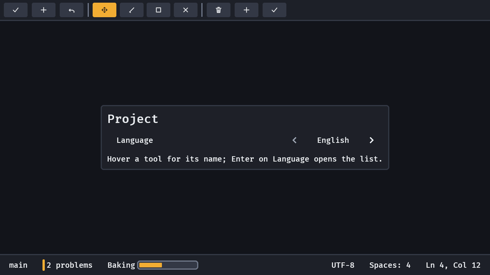

# Toolbars

A tool's modes and frequent commands live in a bar of square glyph buttons. `toolbar` is that bar, `icon_button` a button with a picture and a tooltip for a name, `toggle_group` a row of options of which exactly one is on, and `toolbar_separator` the hairline between groups.

```rust
fn tools(mut commands: Commands, server: Res<AssetServer>) {
    let glyph = |path: &str| IconSource::Image(server.load(path.to_string()));
    commands.spawn((
        toolbar(children![
            (
                icon_button(
                    glyph("save.png"),
                    Tooltip::new("Save").with_shortcut(Shortcut::primary(KeyCode::KeyS)),
                ),
                observe(|_: On<Activate>| info!("save")),
            ),
            toolbar_separator(),
            (
                toggle_group(
                    [
                        GroupOption::icon(glyph("move.png"), Tooltip::new("Move")),
                        GroupOption::icon(glyph("draw.png"), Tooltip::new("Draw")),
                    ],
                    0,
                ),
                observe(|mode: On<ValueChange<usize>>| info!("tool {}", mode.value)),
            ),
        ]),
    ));
}
```



- **A selection indicator slides (`toggle_group`).** Changing the lit option springs one accent node from the old option's rect to the new one's on `motion.snappy` instead of swapping two fills; a change mid-flight turns round from where it is drawn. It is hidden at rest, so the options look as ever; reduced motion and no motion light the option at once, and so does a hop between two rows of a wrapped strip (the puck never crosses the gutter between rows). `SelectionIndicator` is its component and `Indicating` the mark on a strip and its options while it travels.
- **`icon_button(source, tooltip)`** is a [`button`](widgets.md) with an `icon` in it: a square at least `skin.target()` (44 px; 24 px in the Tool look) whose picture follows the button's disabled and pressed state. The tooltip is required because it is the button's name: it shows on hover and on visible focus, with its chord on a keycap. Observe `Activate` on it as on any button.
- **`toggle_group(options, selected)`** has radio behaviour. The option that is on is lit in the accent with its picture in the accent's text colour, as a selected tab is; choosing another (Enter, Space, South, a click) sends one `ValueChange<usize>` on the group with its index and moves the light, and choosing the one that is on sends nothing. `ToggleGroupValue` is the state: set it to change the mode from code and the group follows with no event; a value past the end is pulled back to the last. An option is `GroupOption::icon(source, tooltip)` or `GroupOption::text("Edit")`, either with `.with_tooltip(..)`.
- **`toolbar_separator()`** is a vertical rule in the skin's outline colour (the menu's `separator()` is the horizontal one).
- **Keys.** Every control is a tab stop and the arrows and the D-pad move focus along the row, like every other row of buttons in the crate. (The APG's toolbar is one tab stop with a roving tabindex; a game's pad has no Tab, so here the arrows already reach everything.)

## When the bar is too narrow

The bar fills its parent's width and its items never decide it (it has no width of its own and its parent's as its least, like a progress bar's words): put it where the width is the window's or a panel's (`screen()`, a split pane, a column other widgets size). Alone in a parent that sizes to its content it has no width to fill. When the items are wider than the bar, the **last** items hide (`Display::None`, marked `Overflowed`) and a **More** button takes their place at the end. Its menu lists each hidden item by its tooltip (or its text); choosing a row activates the real item, a hidden toggle group is listed as a radio row for each option with the one on checked, and a hidden separator is a line between rows. Widening the bar shows the items again and takes the button away. Focus on an item that hides moves to **More**.

The widths come from layout, so the bar settles one frame behind a resize; a hidden item keeps the width it had so it returns when the room does (`model::bar_fit` is the rule, and it has no engine in it). 
`examples/tools.rs` shows it; `GOOEY_KEYS="width:560;focus:more;enter"` narrows the bars and opens **More**.
