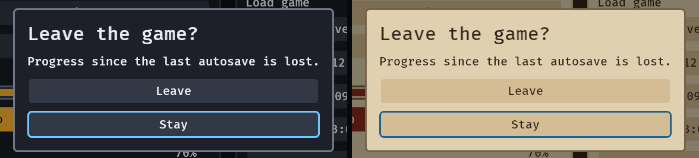

# The widgets

Every widget is a free function returning a bundle, styled only by `apply_skin` through its `Role`, so
they compose inside `children![]` and take `observe` like any Bevy component. Their sizes are the
skin's, so changing `GooeySkin` restyles all of them that frame.

| widget | what it is |
|---|---|
| `screen()` | the layout root: full window, its empty part `Pickable::IGNORE` so a HUD lets the pointer through |
| `panel()` | a raised box a screen's content stands on |
| `surface(level)` | a column filled with one step of the skin's surface ladder (see [skins](skins.md#design-tokens-and-the-surface-ladder)) |
| `menu()` | the column a set of buttons stack in |
| `heading(text)` | a title in the skin's heading size |
| `label(text)` | body text |
| `button(text)` | a Bevy `Button`, so it takes `observe`, `Tooltip` and `InteractionDisabled` |
| `ButtonVariant` on a `button` or `icon_button` | what the button says it does: `Submit`, `Contrast`, `Danger`, `Warning`, `Outline`, `Ghost`, `GhostMuted`, `GhostFaint` (absent is the plain button); `Loading(true)` swaps the label for a spinner, keeps the width and takes no click |
| `primary_button(text)` | the screen's one main action: a `button` with the `PrimaryButton` marker, filled with `accent` and labelled in `accent_text` at rest, lifted 6 L\* toward `text` under the pointer (`primary_hovered()`) and 12 held down (`primary_pressed()`); `problems()` checks the words on both lifts and the steps between the three fills. Move the marker to make another button the main action |
| `meter(value, max)` | a HUD bar; `Meter { value, max }` on the entity drives it, and `update_meters` draws it |
| `tooltip` (`Tooltip::new("…")`) | a component on any widget: its box opens beside the widget under the pointer or on visible focus, with the command's shortcut on a keycap if it has one — see [shortcuts](shortcuts.md) |
| `dialog()` | a modal: a scrim, focus taken on opening and held, and given back to the opener on closing |
| `popover(anchor, placement)`, `popover_modal(..)` | a panel beside a widget or at the pointer, kept inside the window and closed by Escape or a press elsewhere; the modal one holds focus like a menu does — see [popovers](popovers.md) |
| `menu_bar`, `menu_title`, `menu_item`, `check_item`, `radio_item`, `submenu`, `separator` | a bar of titles and the menus they open, with chords, checks, radio runs, submenus and `Disabled` items that say why; walked by F10, the arrows and the pad — see [menus](menus.md) |
| `context_menu(items)` | a menu that belongs to things: name it with `ContextMenu(menu)` on any entity and a right-click or Shift+F10 opens it — see [context menus](context-menus.md) |
| `command_palette()` | a modal field over every command in `CommandList`, fuzzy-ranked, with chords and reasons; Enter or a click sends one `RunCommand` — see [the command palette](command-palette.md) |
| `toggle`, `choice`, `slider` | the options-screen controls, on Bevy's own `Checkbox`, `Button` and `Slider` — see [controls](controls.md) |
| `radial` | a weapon wheel: items on a ring a stick, the pointer or the D-pad points at — see [radial menu](radial.md) |
| `text_size`, `interface_size`, `pad_style`, `skin_preset`, `motion_row` | the player's text size, interface size, controller, theme (Dark, Parchment, High contrast, Tool) and motion (Full, Reduced, Off), as `choice` rows that edit the crate's own settings and follow them, with nothing to wire — see [player options](options.md) |
| `tabs`, `tab_page` | a strip of labels over pages of widgets, turned by a click, the arrows and the pad's bumpers — see [tabs](tabs.md) |
| `list` | rows that scroll and follow focus — see [lists](lists.md) |
| `tree(nodes)` | nodes that open and close, ten thousand in a dozen entities: the table's rows in one column, indented, with a chevron, Right and Left, type-ahead and a selection by key — see [trees](trees.md) |
| `split(axis, first, second)` | two panes with a divider a drag, the arrows, the D-pad or a double click moves; `SplitFraction` is the state and `SplitMin` each pane's least size — see [split panes](splits.md) |
| `dock(layout)` | a workbench of tab groups and splits kept as a `DockLayout`, whose panels come from the `PanelRegistry` and which the player rearranges by dragging a tab or with Ctrl+Shift and an arrow — see [docks](docks.md) |
| `toast`, `toast_alert` | a line of news at the edge of the screen — see [toasts](toasts.md) |
| `binding` | a row that rebinds a key, a mouse button, a pad button or a key chord on the player's next press — see [rebinding](bindings.md) and [shortcuts](shortcuts.md) |
| `prompt`, `prompts` | the "Esc Back" hints in the corner, in the words of the last device the player used — see [prompts](prompts.md) |
| `text_input` | a row with a field the player types in — a caret, a selection, paste and IME on Bevy's own `TextInput`, a hint, and focus it never traps — see [text input](text-input.md) |
| `combobox(label, options)` | a field with a list under it that narrows as the player types: Down, Ctrl+N and Ctrl+P walk it, Enter or a click chooses, one `ValueChange<String>` with the option's id — see [combobox](combobox.md) |
| `number_field`, `vec_field` | a row with a number the player scrubs with a drag on its label, types, or steps with Up, Down and the D-pad, held to a range, with a mixed value for a multi-selection; `vec_field` is a row of them for a position — see [numbers](numbers.md) |

## A meter

```rust
use bevy::prelude::*;
use bevy_gooey::*;

fn hud(mut commands: Commands) {
    commands.spawn((
        screen(),
        children![(panel(), children![label("Health"), meter(72.0, 100.0)])],
    ));
}
```

`Meter { value, max }` is the state: write it and the next `update_meters` draws the fill. The frame
(`outline`) and the gap round the fill are drawn whole device pixels wide, so the fill sits centred in
its slot at every scale.

A meter moves as its value does (see [motion](motion.md)): a loss drops the fill at once and leaves the
lost length behind it, in the skin's `danger` colour, for about half a second before it drains; a gain
eases up with no trail. `MotionSettings::off()` makes both instant.

## A tooltip

`Tooltip` is a component whose text is the hint, built `Tooltip::new("Sound, controls and display")`. It
opens beside its widget — to the right in a column, below in a row, flipped at the window's edge — one
step outside its panel, so it never covers the next button. It is a view of its component:
`commands.entity(button).remove::<Tooltip>()` takes the hint off (a "Locked: reach level 5" line once the
player unlocks it), and inserting a new `Tooltip` or editing `Tooltip.text` changes the line the open box
shows. `.with_shortcut(Shortcut::primary(KeyCode::KeyS))` puts the command's chord on a keycap to the
right of the line, the same cap a `prompt` and a `binding` row draw ([shortcuts](shortcuts.md)). A tooltip on a
widget inside a clipped container (a row of a `list`) draws over the clip rather than being cut by it.

The box opens after the pointer has rested on the widget for `TooltipSettings::delay_seconds` (half a second by default), so moving across a toolbar does not flash a row of them. A press, a wheel turn or a key press hides it, and it stays hidden until the pointer leaves and comes back. A widget with visible focus opens its tooltip at once.

## A dialog

**A dialog's default button is `DefaultButton`** on one button (or `confirm(..).default(index)`): Return in a single-line field ends its edit and then presses it, Return with nothing focused presses it, and it draws as the main action. A focused button and a text area keep their own Return.

**A question with choices is one line: `confirm(title, body, choices)`.** It spawns the dialog, its
panel, the title, the line of body (none when it is empty) and a button for each choice, and answers
with one `ConfirmChosen { entity, index, cancelled }` before it despawns itself. The last choice is
the safe one: it has focus when the dialog opens, and Escape or the pad's B answers with it
(`cancelled: true`); `.safe(0)` moves it when the safe choice comes first. Enter, Space, South and a
click answer with the button's own index. Focus goes back to the opener, as for any dialog.

```rust
commands.spawn((
    confirm("Leave the game?", "Progress since the last autosave is lost.", ["Leave", "Stay"]),
    observe(|chosen: On<ConfirmChosen>, mut exit: MessageWriter<AppExit>| {
        if chosen.index == 0 {
            exit.write(AppExit::Success);
        }
    }),
));
```

Use the `dialog()` form below when the dialog holds something of its own (a slider, a text field).
Research: `docs/research/confirm.md`.

`dialog()` is the modal wrapper; spawn the dialog's own `panel()` inside it. Focus moves to its first
button when it opens, Tab, the arrows and the D-pad cannot leave it, and closing it puts focus back on
the button that opened it. Put `AutoFocus` on the dialog's safest choice ("Stay", "Cancel") to start
there instead.

A `panel()` that is a direct child of the dialog is the dialog, and looks like one: it is 21 to 36 body
text sizes wide (420 to 720 px at the default size, and it grows with `text_scale`), so a short title
fills the least and a long body wraps at the most; it has one and a half times a screen panel's padding
and gap, an opaque fill, and its frame in the skin's `outline` colour (3:1 against the panel, checked
by `problems()`), so its edge is the first thing the eye finds on the dimmed screen. The scrim keeps the
outer 5% of the window clear, which a TV may not show, so a dialog never reaches the bezel. Put in it a
`heading` (the main instruction), a `label` (what the choice costs) and a `menu` of the choices, in that
order, and name each choice for what it does ("Leave", "Stay"), not "Yes" and "No". A panel wrapped in
another node inside the dialog is a screen's panel again.

```rust
fn quit(mut commands: Commands) {
    commands.spawn((
        dialog(),
        children![(
            panel(),
            children![
                heading("Leave the game?"),
                label("Progress since the last autosave is lost."),
                (menu(), children![(button("Leave"), observe(|_: On<Activate>, mut exit: MessageWriter<AppExit>| { exit.write(AppExit::Success); })), (button("Stay"), AutoFocus)]),
            ]
        )],
    ));
}
```



## Over a game world

A `screen` is layout, not a surface: its empty part is `Pickable::IGNORE`, so a HUD on it lets the
pointer through to the sprites, meshes and UI roots under it (a world sprite opts in to picking with
`Pickable::default()`), while a `panel`, `button`, `meter` or `dialog` on it still takes the pointer, so
a click on one never reaches the world. A click on the empty part still blurs the interface. A menu
screen that must swallow the pointer: `commands.spawn(screen()).insert(Pickable::default())` — a bundle
cannot carry `Pickable` twice, so this is an insert and never part of the spawn's tuple.

See [the pointer](pointer.md) for the rules a HUD and a menu share.
